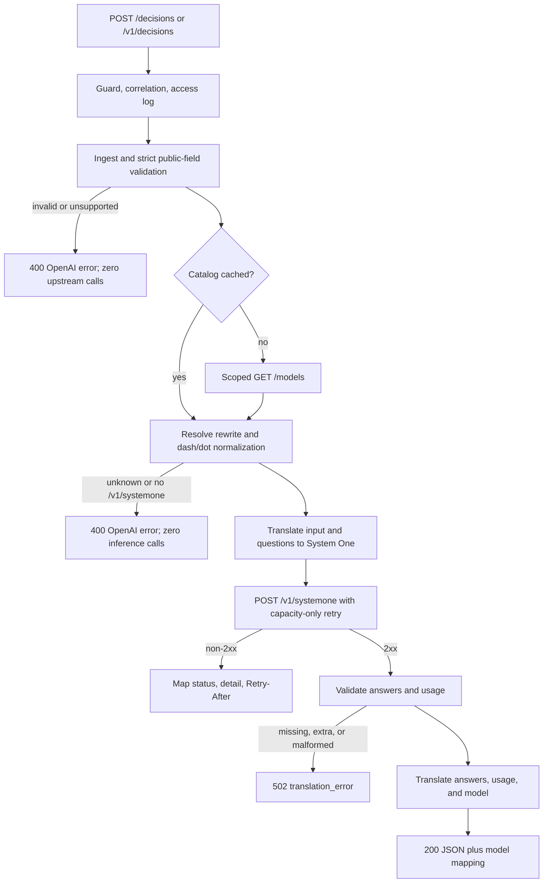

# OpenAI Decisions API support - Plan

## Goal Capsule

- **Objective:** A Copilot decision model that advertises `/v1/systemone` can be called through ghc-proxy's OpenAI-compatible Decisions endpoint and returns typed predicate, choice, and score answers; unsupported requests are rejected before any upstream call.
- **Means:** A direct JSON route plus a request-local translator and a capacity-only `/v1/systemone` client call (`KTD1`).
- **Authority:** The Product Contract owns behavior; the Key Technical Decisions own mechanism. Implementation units may refine local details but must not weaken either contract.
- **Execution profile:** Standard, one pull request, test-first translation with hermetic route and transport coverage. Automated tests never consume live Copilot quota.
- **Stop conditions:** Stop and revise the translation if the controlled live probes show Copilot's `/v1/systemone` contract differs materially from the documented System One shape. If the upstream exposes a lower question ceiling, keep the public validator at 400 and record the upstream limitation; do not batch or shrink silently. Do not add image or System One passthrough.
- **Tail ownership:** The implementer owns code, tests, docs, and the full gate. The user owns live-probe approval and release.

---

## Product Contract

### Summary

Add `POST /decisions` and `POST /v1/decisions` to ghc-proxy. The route accepts the OpenAI Decisions request shape, translates text and JSON evidence plus predicate/choice/score questions into System One `state` and keyed questions, calls the Copilot upstream `/v1/systemone`, and returns typed answers, usage, and OpenAI-shaped errors. Image parts and upstream-only fields are rejected explicitly in v1.

### Problem Frame

The Copilot catalog now advertises `microsoft-decision-1` with its only inference endpoint at `/v1/systemone`. ghc-proxy lists the model in its dashboard and `/models` response, but exposes no client route that can reach that endpoint, so the model is visible and unusable. The proxy's compatibility contract requires any new public route to match the official client-facing schema, and the upstream wire format is System One rather than OpenAI Decisions. Supporting the model therefore requires an explicit translation boundary and an admission gate, not a generic passthrough.

The work is model-agnostic at the route boundary: any model that advertises `/v1/systemone` is eligible. It does not change how decision models behave on Chat Completions, Responses, or Messages, and it does not claim that the decision model generates text.

### Requirements

**Route and admission**

- R1. One route plugin registers `POST /decisions` and `POST /v1/decisions`; both paths use the existing guard, request correlation, JSON delivery, and OpenAI error serializer. No streaming, GET, or `/systemone` alias is added.
- R2. The route resolves the requested model through the existing model resolver, including configured rewrites and advertised dash/dot normalization. It rejects a model that is absent from the cached catalog or does not advertise `/v1/systemone` with an OpenAI `invalid_request_error` 400 before any upstream inference call; a structurally valid cold-cache request may first load the catalog under R11.
- R11. A structurally invalid or unsupported request makes zero upstream calls, including a cold-cache `GET /models`. A valid request with an empty catalog may lazily load the catalog, scoped to the current account, before model resolution; a catalog-load failure keeps its upstream or timeout status rather than becoming a model-unsupported 400.

**Request policy and translation**

- R3. The public request contract is the OpenAI Decisions schema. v1 accepts text and JSON evidence. It rejects `input_image` in any location, function/custom-tool call and output items, assistant refusal and phase fields, and cache breakpoints with an explicit 400 unsupported error before any upstream call.
- R4. Accepted optional fields with no System One equivalent (`safety_identifier`, `prompt_cache_key`, `prompt_cache_options`) are rejected with 400 when non-null; omission is preserved. Unknown top-level or question-level fields, including `stream`, are rejected with 400. Explicit `null` is treated as omission only for the named optional fields.
- R5. String input maps to a string `state`. Message arrays preserve order, roles, and part boundaries in an ordered structured `state`; `input_json` data remains inert JSON evidence. Empty input and empty names are preserved, never replaced with placeholder content.
- R6. `predicate`, `choice`, and `score` map to System One `noul`, `choice`, and `score`. Questions use request-local index keys, while original names are echoed in answers. Typed choice values remain distinct, including a boolean `true` and the string `"true"`. Score levels preserve their original labels and order.

**Response, errors, and transport**

- R7. Upstream responses are validated before translation. Answers are returned in question order with typed choices, original score labels, finite probabilities and confidence, usage, and the upstream model. Missing, extra, mismatched, or malformed answers produce a 502 `translation_error`; the proxy never fabricates a refusal, a zero score, or zero-filled success.
- R8. Upstream non-2xx responses become the OpenAI error envelope with the upstream status, a bounded safe message, public question paths where the upstream identifies them, and `Retry-After` when present. The System One client path normalizes the response before the shared upstream logger sees it; raw rejected evidence and upstream `detail.input` are never logged or returned.
- R9. The upstream call is `POST /v1/systemone` through the existing Copilot client, auth, account-scoped queue, upstream deadline, and abort signal. It uses capacity-only retry, never retries 400/422, ambiguous 408/5xx, JSON-decoding failures, or translation failures, and does not enable model overload fallback for this route.
- R10. A caller abort is honored before catalog load, before upstream dispatch, and while the upstream body is read. An abort observed before dispatch makes no inference call; an abort during queue wait prevents dispatch; an abort during the upstream body read stops the work, releases the lease, and records aborted without inventing a failed or timeout outcome.

**Observability, documentation, and proof**

- R12. Both paths are classified in the request store, and the original/effective model mapping reaches both the request store and the access-log mapping. The dashboard DTO shape and all other routes remain unchanged.
- R13. Documentation records the public surface, the accepted subset, the `/v1/systemone` gate, the error behavior, and the decision not to place Decisions coverage in the Anthropic-only translation matrix.
- R14. Hermetic tests cover schema and translation, route admission, transport retry and abort, contract smoke, and a real-listener error case. No automated test consumes live Copilot quota.

### Key Decisions

- KD1. **v1 accepts text and JSON evidence; images return 400.** `(session-settled: user-directed — chosen over JEV-style image/assets support: Microsoft-Decision-1 is officially text-only and Copilot's `/v1/systemone` image contract is unverified.)` Governs R3, R7, R13.
- KD2. **Only the OpenAI-facing Decisions route is exposed.** A native `/v1/systemone` passthrough is not part of this feature, so TypeSafe-format clients are not claimed as supported. Governs R1, R13.
- KD3. **Admission is an exact endpoint-advertisement check.** The route reads only `supported_endpoints`; it does not infer decision capability from vendor, chat capabilities, or the Messages fallback route. Governs R2, R12.
- KD4. **OpenAI Decisions owns the public contract; System One owns the upstream contract.** Public field names, answer types, and usage stay OpenAI-shaped, while `state`, `noul`, and keyed questions stay internal. SGLang's top-level `images` extension is not treated as the Copilot contract. Governs R3-R8.

### Scope Boundaries

- In scope: the two Decisions paths, the public schema subset, OpenAI-to-System-One request translation, System-One-to-OpenAI response translation, error normalization, upstream transport wiring, model admission, observability classification, tests, and docs.
- Not in scope: image and media assets, native `/v1/systemone` passthrough, M365 catalog support for decision models, model overload fallback, streaming, and any change to Chat Completions, Responses, or Messages for decision models.

#### Deferred to Follow-Up Work

- Image support through System One `assets`, placeholders, and the image opt-in header, if Copilot exposes an image-capable decision model or confirms the image contract.
- A native `/v1/systemone` client route for TypeSafe-format clients.
- M365 catalog normalization for decision models, which currently drops entries without `/v1/messages`.
- Overload fallback for decisions, which would need an endpoint-specific target gate and an explicit model-switch semantic.
- Tool-call and assistant-refusal evidence, if a real System One contract defines a faithful mapping.

#### Outside this product's identity

- Turning `microsoft-decision-1` into a text-generation model, or changing its Messages route away from the existing `chat-completions` fallback label.
- Injecting synthetic model entries or changing the dashboard's model row shape.
- Running live Copilot probes in CI or treating a cheap mock 200 as upstream contract proof.

### Success Criteria

- Authorized live probes with `microsoft-decision-1` return typed predicate, choice, and score answers through `/v1/decisions`, or the probes expose a wire mismatch that is handled before release.
- Every unsupported or invalid public request path returns a 400 before any upstream call, and the contract tests prove zero calls.
- The dashboard's copied model row for `microsoft-decision-1` keeps its current fields and values.

### Acceptance Examples

- AE1. **Predicate happy path.** Given a model that advertises `/v1/systemone`, a string input, and one named predicate question, when the client calls `/v1/decisions`, then the upstream receives a string `state` and one `noul` question and the response contains `{ type: "predicate", name, probability }` with mapped usage. Covers R2, R5-R7.
- AE2. **Typed choice.** Given choices `[true, false, "true"]`, when translation runs, then the System One criteria keys are injective and preserve all three typed options, the response restores the selected boolean or string, and probabilities keep the original typed values. Covers R6, R7.
- AE3. **Score.** Given levels `[calm, angry]`, when translation runs, then the upstream criteria preserve order and labels, and the response uses the original label for each probability while keeping the fractional score. Covers R6, R7.
- AE4. **Unsupported media.** Given an `input_image` part in a message or question instruction, when the request is validated, then the client receives a 400 unsupported error and no `GET /models` or `POST /v1/systemone` occurs. Covers R3, R11.
- AE5. **Model admission.** Given an unknown model, a cached chat-only model, or a model without `/v1/systemone`, when the request is admitted, then the client receives a 400 naming the model and no upstream inference call occurs. Covers R2.
- AE6. **Sparse model.** Given a cached model with no `capabilities` or `limits` but with `/v1/systemone`, when a valid request runs, then admission succeeds without reading chat metadata. Covers R2, R12.
- AE7. **Upstream validation error.** Given an upstream 422 with a `detail` array, when the error is normalized, then the client receives an OpenAI envelope with the upstream status, a bounded message, mapped question paths, and no `detail.input` evidence. Covers R8.
- AE8. **Malformed success.** Given a 200 upstream body with a missing answer, an unknown choice key, or a non-finite probability, when the response is translated, then the client receives 502 `translation_error`, not a partial 200 or a fabricated refusal. Covers R7.
- AE9. **Names and keys.** Given unnamed, empty, duplicate, or prototype-like question names, when translation runs, then every question gets a unique internal key and each answer carries the original name or `null` in request order. Covers R6, R7.
- AE10. **Cancellation.** Given a caller abort before dispatch, during queue wait, or during upstream body read, when the abort is observed, then no further inference is dispatched, any in-flight work is stopped, the lease is released, and the request is recorded as aborted. Covers R10.
- AE11. **Alias parity.** Given the same valid body sent to `/decisions` and `/v1/decisions`, when both run, then validation, guard, correlation, translation, and the upstream request are identical. Covers R1, R12.

---

## Planning Contract

### Key Technical Decisions

- KTD1. **Use a direct `route.ts` + `handler.ts`, not a strategy registry or `runPipeline`.** Decisions has one upstream endpoint and no model-dependent strategy dispatch. The handler reuses ingest, the client factory, the upstream signal/deadline helper, and the global error serializer, and it explicitly applies the shared model resolver plus the endpoint gate. This follows the repository's simple-endpoint convention and avoids the pipeline's overload-fallback assumptions. A reversible internal seam did not justify a bake-off.
- KTD2. **Keep one canonical field and question-mapping owner.** Public types, unsupported-field policy, question-kind mapping, key generation, and typed-value encoding live in one translator module; validation and both translation directions import it. A second hand-written mapping would let accepted fields and translated fields drift. This follows the repository's duplicated-semantic-rule convention.
- KTD3. **Use request-local index keys and injective typed-choice handling.** Every question key is `q{index}`, because question keys are not visible to the model and public names may be absent, empty, duplicated, or collide with synthesized names. Original names are kept in a request-local map and echoed in answers. Choice values use natural string keys when all values are distinct strings; when a string/boolean collision exists, the question switches to `c{index}` keys with the original typed value and description rendered into the criteria description. In collision mode only, rendering the typed value into that description is a required mapping decision, not a caller default. Responses reverse-map through the same request-local map. Prototype-like names are data, never object keys.
- KTD4. **Validate the upstream response before translating it.** The client's generic JSON cast is not a contract check. The response translator requires every submitted key, the expected answer type, known choice keys or score indices, finite numbers, and core usage counts. Any mismatch is a 502 `translation_error`; only an explicit upstream refusal type becomes a public refusal.
- KTD5. **Use capacity-only retry and no model fallback.** The new client method uses the completion retry class, not the embeddings class: only 429/529 and the existing approved pre-connection failures may replay. Ambiguous 5xx, timeouts after dispatch, decode failures, and translation failures are terminal. No overload fallback is configured for this route, so a decision request can never switch to a model that cannot serve System One.
- KTD6. **Normalize errors at the Decisions boundary without a second framework serializer.** The handler throws `HTTPError` and the shared `toErrorResponse` owns the wire. The Decisions error helper maps upstream `{detail}` and 422 arrays into a bounded OpenAI envelope, preserves the upstream status and `Retry-After`, and maps internal question keys back to public indexes without copying rejected evidence.
- KTD7. **Record the mapping in both existing owners and document coverage in a Decisions-specific doc.** The route writes the model mapping to the request store and the access-log mapping, and adds both paths to the known-endpoint set. It does not add a dashboard card or effects. Coverage lives in a new indexed `docs/design/decisions-api.md`; the Anthropic-only translation matrix is not repurposed.

### High-Level Technical Design

The request path has four gates before the upstream call: public-field validation, model admission, translation completeness, and transport policy. The response path has a single hard gate: a malformed success body becomes a 502 rather than a partial answer.

Translation policy index (the Requirements own the rules; this table is a review aid):

| Public input | System One output | Policy |
|---|---|---|
| `model` | resolved upstream `model` | Exact after admission (R2) |
| `input` string | `state` string | Exact (R5) |
| `input` message array | ordered structured `state` | Data-preserving; role hierarchy is evidence-only, not an OpenAI instruction hierarchy (R5) |
| `input_json` data | inert JSON inside `state` | Exact data preservation, never executed (R5) |
| `questions[].name` | internal `q{index}` key | Identity mapped back in answers (R6) |
| `predicate` | `noul` | Exact kind translation (R6) |
| `choice` | `choice` criteria | Typed values preserved with injective keys (R6) |
| `score` | `score` criteria | Labels, order, and fractional result preserved (R6) |
| Images, tools, refusals, phase, breakpoints | none | Explicit 400 (R3, R4) |
| `safety_identifier`, cache fields | none | Explicit 400 when non-null (R4) |
| System One answers | OpenAI answer array | Ordered and runtime-validated (R7) |
| `usage.input_tokens` / `output_tokens` | OpenAI usage | Required core counts; unreported detail counters use 0 as a documented compatibility convention (R7) |
| Upstream `model` | response `model` | Exact upstream value; missing value is 502 (R7) |

### Assumptions and Verification Gaps

- Copilot's `/v1/systemone` accepts the documented System One text shape for `state`, `questions`, answers, and usage. The endpoint advertisement is user-supplied evidence; two controlled probes before release cover the string/predicate baseline and the structured-message/JSON, typed-choice, and score shapes.
- The public 1..400 question ceiling is accepted as one upstream request. The real Copilot cap is unverified; a lower cap must surface as an upstream error, not a silently reduced validator or automatic batching.
- No Copilot refusal wire representation is known. Only an explicit refusal type is mapped; missing or mismatched answers are protocol failures.
- The cached `microsoft-decision-1` record may omit `capabilities` and `limits` at runtime even though the TypeScript model type marks them required. The route reads only `supported_endpoints` and must not widen the model type or fill chat defaults.

### Risks and Dependencies

| Risk | Consequence | Mitigation |
|---|---|---|
| Copilot's System One wire shape differs from the documented TypeSafe shape | The route could translate a valid public request into an upstream 400 | Pin the documented schema in hermetic fixtures; run the controlled probe before release; stop and revise on a material mismatch |
| Sparse model metadata conflicts with the `Model` type | A chat-shaped code path could throw before admission | Gate only on the catalog lookup and `supported_endpoints`; test a sparse fixture; do not read `capabilities` or `limits` |
| Error envelope drift across runtimes | Clients lose status, `Retry-After`, or request correlation | Reuse `HTTPError` and the global `toErrorResponse`; add a real-listener selfcheck case; run `smoke:packaged` |
| Decision content is sensitive | An upstream error body could reach a log before the Decisions normalizer runs | Normalize upstream errors in the client's non-2xx hook before the shared logger; do not rely on post-hoc redaction; do not log decision bodies or answer evidence |
| Upstream retry double-counts quota | A replay after an ambiguous 5xx could charge twice | Capacity-only retry; no fallback; tests distinguish 429/529 from ambiguous 5xx and 408 |

### System-Wide Impact

- One new public route surface at the root and `/v1`; existing Chat, Responses, Messages, Models, Embeddings, Token, Usage, and Dashboard behavior is unchanged.
- The existing guard, rate limiter, account routing, queue, timeout, abort, correlation, and error serializer are reused; the feature must not build parallel versions.
- The request store gains two known endpoints and model mapping; the dashboard DTO and copied model row do not change.
- Documentation and the glossary gain Decisions/System One vocabulary; the Anthropic translation matrix keeps its existing scope.

---

## Implementation Units

### U1. Wire types, ingest validation, and public field policy

- **Goal:** Establish the typed public and upstream wire contracts, the strict request schema, and the explicit unsupported-field matrix used by all later units.
- **Requirements:** R3, R4, R5 (validation portion), R11.
- **Dependencies:** None.
- **Files:**
  - `src/types/decisions.ts`
  - `src/types/index.ts`
  - `src/ingest/types.ts`
  - `src/ingest/decisions.ts`
  - `src/ingest/index.ts`
  - `src/ingest/validation/decisions.ts`
  - `src/ingest/validation/index.ts`
  - `tests/validation.test.ts`
  - `tests/decisions-translation.test.ts`
- **Approach:**
  1. Define the public Decisions request/response/usage types and the System One request/response/answer types in one module, following the existing `src/types` style; export them through the existing barrel.
  2. Add an `openai-decisions` protocol and a Zod schema for the envelope: required non-empty model, string-or-array input, 1..400 questions with the three supported kinds, and the public per-kind structural limits.
  3. Encode the unsupported matrix explicitly: image parts, function/custom-tool items, assistant refusal/phase, cache breakpoints, non-null `safety_identifier`, non-null cache fields, unknown top-level and question fields, and `stream` are 400 errors. Named optional `null` is omission.
  4. Validate the documented JSON-part limits (32 container levels, 10,000 values, 256 KiB compact UTF-8) without inventing a global HTTP body cap. Keep empty input, empty names, and empty instructions legal.
  5. Return validation errors through the existing `parsePayload` path so the public error envelope and the sanitized logging behavior are preserved.
- **Patterns to follow:** `src/ingest/embeddings.ts`, `src/ingest/validation/embeddings.ts`, `src/ingest/validation/shared.ts`, `tests/validation.test.ts`.
- **Test scenarios:**
  - A minimal valid request with one predicate parses with the exact model, input, and question fields.
  - Zero questions and 401 questions both return 400 with the question array path.
  - Choice with 1 or 256 options, and score with 1 or 11 levels, both return 400.
  - A top-level `stream` field and an unknown question field return 400 even when their value is `false` or `null`.
  - Non-null `safety_identifier`, `prompt_cache_key`, `prompt_cache_options`, and a nested cache breakpoint return 400; explicit `null` for the named optional fields is accepted.
  - Empty string input, empty question name, and empty instructions are accepted and preserved.
  - An `input_json` structure beyond a JSON-part limit returns 400 with a bounded path; a legal nested JSON object is accepted.
  - An image part, tool item, assistant refusal, and phase field each return 400 with a distinct unsupported code.
  - An assistant `output_text` part is accepted and preserved as evidence; a `refusal` content part is rejected.
  - An `input_json` part on a non-user role returns 400; the same part on a user message is accepted and preserved.
- **Verification:** The protocol parses from the registry, every accepted field reaches a typed payload, and every rejected field returns the shared invalid-request envelope without side effects.

### U2. Request translation and canonical mapping

- **Goal:** Translate the accepted public request into one System One request while preserving question identity, evidence order, role boundaries, and typed choice values.
- **Requirements:** R5, R6.
- **Dependencies:** U1.
- **Files:**
  - `src/translator/decisions/mapping.ts`
  - `src/translator/decisions/openai-to-systemone.ts`
  - `tests/decisions-translation.test.ts`
- **Approach:**
  1. Put the canonical question-kind mapping, key generation, typed-choice encoding, and score criteria rendering in one mapping module; both translation directions import it.
  2. Build `state` from a string input as a string, and from a message array as an ordered structured value that keeps roles, parts, and JSON data. Do not flatten roles into an unlabeled string and do not promote system/developer content into question instructions.
  3. Generate `q{index}` keys for every question and retain the original name, kind, choice value map, and level map in the request-local translation result.
  4. For choices, use natural string keys when all values are distinct strings. If a string/boolean collision exists, use `c{index}` keys and put the original typed value plus description into the criteria description. Reject duplicate typed values; use prototype-safe dictionaries or Maps for criteria and reverse mapping so `__proto__` and `constructor` are ordinary values.
  5. For scores, render each level as its label, or `label: description` when a description is present, and preserve the original label by index for the response.
  6. Translate `predicate` to `noul`, and keep question instructions as a deterministic text/JSON rendering; the mapping result owns the reverse lookup for the response.
- **Patterns to follow:** `src/translator/responses/responses-to-chat.ts` for explicit unsupported failures, `src/translator/anthropic/translation-issue.ts` for failure shape, and the existing translator tests for typed fixture matrices.
- **Test scenarios:**
  - A string input maps to an identical string state.
  - A two-message array with different roles preserves order, roles, and part boundaries; a JSON part remains inert data.
  - A predicate question maps to `noul` with the same instructions and a `q0` key.
  - A choice with string values uses those values as criteria keys; a boolean choice uses stable boolean keys; the mixed `true` plus `"true"` case uses injective keys and preserves all options.
  - A choice value `__proto__` or `constructor` round-trips as an ordinary string without changing any object prototype.
  - A score with duplicate or empty labels preserves every level by index and does not deduplicate.
  - Unnamed, empty, duplicate, and prototype-like public names all produce unique `q{index}` keys and retain their original names for the response.
  - An omitted level description and an explicitly empty description remain distinguishable in the rendered criteria.
  - Translation never emits `state`, `noul`, or `criteria` on the public side and never emits public `questions` or `answers` on the upstream side.
- **Verification:** One request-local mapping object can reconstruct every public answer identity and typed value without re-parsing the public request.

### U3. Response validation, translation, and error normalization

- **Goal:** Convert a valid System One response into the OpenAI Decisions response and convert upstream failures into bounded OpenAI errors without fabricating answers.
- **Requirements:** R7, R8.
- **Dependencies:** U1, U2.
- **Files:**
  - `src/translator/decisions/systemone-to-openai.ts`
  - `src/translator/decisions/errors.ts`
  - `tests/decisions-translation.test.ts`
- **Approach:**
  1. Validate the upstream body before translation: every submitted key has an answer of the expected kind, choice keys and score indices are known, probabilities and confidence are finite, and core usage counts are finite non-negative integers.
  2. Emit answers in request order, using the original name or `null`, the typed choice value, the original score label, and probabilities in the public array shape. Ignore upstream object ordering.
  3. Compute `total_tokens` from `input_tokens + output_tokens`. Require the core counts; map known cached/cache-write/reasoning fields to details and use 0 for unreported detail counters as a documented compatibility convention.
  4. Return the upstream model value; a missing model is a 502. A missing, extra, wrong-type, unknown-choice, or unknown-index answer is a 502 `translation_error`; only an explicit upstream refusal type maps to a public refusal.
  5. Normalize upstream `{detail}` strings, objects, and 422 arrays into a bounded message and safe path, map internal `questions[qN]` paths to public indexes, preserve the upstream status and `Retry-After`, and drop `detail.input` and raw evidence. The client's non-2xx hook invokes this normalizer before the shared upstream logger sees the response.
- **Patterns to follow:** `src/translator/responses/chat-to-responses.ts` for 502 translation failures, `src/lib/error.ts` for `TranslationFailure`/`HTTPError`, `src/ingest/validation/shared.ts` for bounded validation details.
- **Test scenarios:**
  - A three-answer predicate/choice/score response preserves request order, typed choice values, original score labels, and fractional score.
  - An unnamed question returns `name: null`; a duplicate public name still maps to the right answer by index.
  - A missing answer, an extra answer, a wrong answer type, an unknown choice key, and an unknown score index each return 502 without a partial 200.
  - A non-finite probability, a negative token count, and a missing model each return 502.
  - An explicit refusal answer maps to `{ type: "refusal", name }`; a missing answer never does.
  - Usage with only input/output produces computed total and zero detail counters; a malformed core count returns 502.
  - An upstream 400 `{ detail: "..." }`, a 422 `detail` array, and a 429 with `Retry-After` preserve status and header and produce an OpenAI envelope.
  - A 422 path naming internal `questions[q0]` maps to public `questions[0]`; `detail.input` and raw evidence never appear in the error or logs.
- **Verification:** Valid upstream bodies produce exactly the public answer array; malformed bodies produce only 502 errors; error bodies contain no rejected evidence.

### U4. Upstream client, route, and model admission

- **Goal:** Add the System One JSON client method and the guarded route, with exact model admission, lazy catalog loading, abort handling, and response delivery.
- **Requirements:** R1, R2, R9-R11, R14.
- **Dependencies:** U1, U2, U3.
- **Files:**
  - `src/clients/copilot-client.ts`
  - `src/routes/decisions/route.ts`
  - `src/routes/decisions/handler.ts`
  - `src/lib/upstream-signal.ts`
  - `src/server.ts`
  - `tests/decisions.test.ts`
  - `tests/upstream-transport.test.ts`
- **Approach:**
  1. Add a JSON POST method to the Copilot client for `/v1/systemone` using the existing request helper, with `retryable: 'capacity'` and the final serialized model as `effectiveModel`. Give the method a response-error hook that runs the U3 normalizer before the shared upstream logger receives the body; non-2xx must not enter the generic raw-body logging path. The hook must preserve the existing queue, capacity retry, lease release, `Retry-After`, and 529 recovery behavior; only raw-body logging and normalization change. It returns raw JSON for the translator and never uses the streamable helper.
  2. Implement a direct handler that ingests the payload, rejects invalid/unsupported requests before catalog work, creates the upstream signal helper before catalog work, lazily loads the catalog only when it is empty, resolves the model through the shared resolver with compact policy off, and applies the exact `/v1/systemone` gate.
  3. Extend `src/lib/upstream-signal.ts` so an already-aborted caller signal enters the same tagged client-abort branch as a later abort; do not throw a plain `AbortError`, which the global mapper records as a failure or 504. Create the helper after ingest and use its derived signal for the pre-cancel check, catalog load, dispatch, and body read. Call the client, translate the response, and attach the model mapping to both the request store and the access-log mapping. Do not add a strategy registry, effects, or fallback.
  4. Register one route plugin at the root and under `/v1`; use the existing guard macro, request correlation, signal, and recovery record. An already-aborted request must reach the tagged abort path before any upstream work.
  5. Keep route tests on the existing prototype-patch seam; shared helpers, contract smoke, observability classification, and listener proof are U6.
- **Patterns to follow:** `src/routes/embeddings/route.ts` and `handler.ts`, `src/routes/responses/handler.ts` for strict model admission, `src/clients/copilot-client.ts` for JSON POST methods, `src/server.ts` for mirrored registration, and `tests/upstream-transport.test.ts` for injected fetch.
- **Test scenarios:**
  - Both `/decisions` and `/v1/decisions` return 200 for the same valid body and produce the same upstream request.
  - An unknown model and a cached model without `/v1/systemone` each return 400 and make no inference call.
  - A sparse model with only `supported_endpoints: ["/v1/systemone"]` passes admission.
  - A configured rewrite to the decision model uses the effective model in the upstream body; a rewrite to a chat-only model returns 400.
  - An invalid request with an empty catalog makes no `GET /models`; a valid request with an empty catalog loads the catalog once and then posts; a catalog failure preserves its status.
  - The client method sends `POST /v1/systemone` with the expected body, auth headers, and signal, and uses capacity-only retry.
  - A 429 or 529 is retried; an ambiguous 500, a 408, a malformed 200, and a translation failure are not retried; no fallback target is selected.
  - A 422 carrying a sensitive marker in `detail.input` becomes a bounded OpenAI error, and the marker is absent from the wire body and from captured logs.
  - An already-aborted caller signal produces the tagged client-abort error, records aborted rather than failed or 504, and makes no upstream call.
  - An abort before dispatch makes no inference call; an abort during queue wait prevents dispatch; an abort during the upstream body read stops the work, releases the lease, and records aborted rather than failed.
- **Verification:** A route-level request reaches `/v1/systemone` exactly once on success and zero times on every invalid or admission failure.

### U6. Observability, contract smoke, and listener proof

- **Goal:** Classify both paths, expose the model mapping, extend shared helpers and contract fixtures, and prove the OpenAI wire error contract through a real listener.
- **Requirements:** R12, R14.
- **Dependencies:** U4.
- **Files:**
  - `src/observability/request-store.ts`
  - `src/selfcheck.ts`
  - `tests/helpers.ts`
  - `tests/contract-smoke.test.ts`
  - `tests/decisions.test.ts`
- **Approach:**
  1. Add `/decisions` and `/v1/decisions` to the known observed endpoints and assert the request store classifies both and exposes the original/effective model mapping without changing the dashboard DTO.
  2. Extend the test helpers with a typed decisions mock and an app selector, following the embeddings pattern.
  3. Add a contract-smoke fixture for a valid decisions response and an invalid request that proves zero upstream calls and the public error envelope.
  4. Add a Decisions rejection case to the selfcheck real-listener error probe (unknown model or unsupported field plus a synthetic upstream failure) so Bun and Node wire behavior is exercised by the packaged smoke.
- **Patterns to follow:** `src/observability/request-store.ts`, `src/selfcheck.ts`, `tests/helpers.ts`, and `tests/contract-smoke.test.ts`.
- **Test scenarios:**
  - The request store classifies both paths and exposes the original/effective model mapping; the dashboard model row shape is unchanged.
  - The contract smoke fixture accepts a valid predicate response and rejects an unsupported field with 400 and zero upstream calls.
  - The selfcheck listener returns the expected status, JSON content type, envelope, `x-request-id`, and `Retry-After` for the Decisions rejection cases.
- **Verification:** The request store, contract smoke, and packaged listener probes exercise the new paths without changing the dashboard DTO or any other route.

### U5. Documentation and glossary

- **Goal:** Make the new surface, its limits, and its failure behavior discoverable without mislabeling existing translation coverage.
- **Requirements:** R13.
- **Dependencies:** U6.
- **Files:**
  - `README.md`
  - `docs/design/decisions-api.md`
  - `docs/design/README.md`
  - `docs/design/architecture-overview.md`
  - `docs/design/model-routing.md`
  - `CONCEPTS.md`
  - `tests/AGENTS.md`
- **Approach:**
  1. Add a short design doc covering the public route, the System One translation table, the admission gate, the unsupported subset, the capacity-only retry, and the live-probe status.
  2. Update the README endpoint and alias lists, the architecture endpoint table, and the model-routing admission section. State that the route is a direct JSON path and does not inherit pipeline fallback.
  3. Add the Decisions/System One vocabulary to the glossary only where the plan uses project-specific terms.
  4. Update the test helper inventory because U6 adds a decisions mock or app selector. Record explicitly that the Anthropic translation matrix keeps its existing scope and that the AGENTS cross-protocol instruction is satisfied by the Decisions design doc and index entry.
- **Execution note:** This is documentation work; use the repository's doc review rather than runtime tests.
- **Test expectation:** none -- documentation and glossary only.
- **Verification:** Every new route and limitation appears in the README/design index, and no document claims image, streaming, or System One passthrough support.

---

## Verification Contract

| Check | Command | Proves |
|---|---|---|
| Focused translation and route | `bun test tests/decisions-translation.test.ts tests/decisions.test.ts` | Request/response translation, admission, zero-upstream rejection, abort, mapping |
| Adjacent contract coverage | `bun test tests/validation.test.ts tests/upstream-transport.test.ts tests/contract-smoke.test.ts` | Schema errors, transport retry/headers, publish-schema compatibility |
| Static checks | `bun run lint:all && bun run typecheck` | Style and type contract, including the sparse-model fixture |
| Repository gate | `bun run lint:all && bun run typecheck && bun test --path-ignore-patterns='**/token-file-removal.test.ts' --path-ignore-patterns='**/token-refresh-retry.test.ts' && bun test tests/token-file-removal.test.ts tests/token-refresh-retry.test.ts && bun run build && bun run smoke:packaged` | Full local CI equivalent and packaged Bun/Node smoke, including the selfcheck listener |
| Controlled live probes | Two authorized `POST /v1/decisions` calls with `microsoft-decision-1`: a string-input predicate baseline, then structured message/JSON evidence with mixed predicate, a choice containing `true` plus `"true"`, and a score; optionally a 400-question probe when the user approves the quota; not part of CI | The real Copilot `/v1/systemone` text contract across both translation shapes and, when run, the upstream question ceiling |

Automated tests must not call live Copilot, `matrix:live`, or any real quota endpoint. The live probes are a release gate owned by the user; if they are not approved, the plan ships with an explicitly recorded unverified upstream contract, not a claim of compatibility.

---

## Definition of Done

- R1-R14 are implemented, and the route is reachable at both `/decisions` and `/v1/decisions` with the same behavior.
- Structurally invalid or unsupported requests return 400 with zero upstream calls, including a cold-cache `GET /models`. A structurally valid cold-cache request may load the catalog; an unknown-model or non-`/v1/systemone` result then returns 400 with zero inference calls.
- The translation table is covered by tests for string input, structured message/JSON evidence, predicate, typed choice, score, unnamed/duplicate names, sparse models, malformed success, upstream 4xx, and abort.
- The upstream call uses `/v1/systemone`, capacity-only retry, no overload fallback, the existing queue/auth/timeout, and records the original/effective model in both existing owners.
- The public 400-question ceiling is accepted as one upstream request; a lower upstream ceiling is recorded as a limitation with its error, never silently reduced or batched.
- The real-listener selfcheck and packaged smoke pass under Bun and Node; the dashboard model row shape and the Anthropic translation matrix scope are unchanged.
- Aborted requests, including a signal already aborted before the handler runs, are recorded as aborted rather than failed or timed out through the shared tagged client-abort path.
- Sensitive upstream evidence is absent from both the wire error and captured logs, including a 422 `detail.input` probe.
- Documentation and the glossary describe the supported subset, the admission gate, the error behavior, and the unverified upstream probe status.
- No image, streaming, `/v1/systemone` passthrough, tool-call, or M365 behavior is present or claimed. Temporary probe scripts and abandoned experimental code are removed.

---

## Appendix

### Sources and Research

- OpenAI, [Create a decision](https://developers.openai.com/api/reference/resources/decisions/methods/create): public request, answer, usage, and error contract; 1..400 questions, typed choices, score levels.
- TypeSafe, [System One API](https://docs.typesafe.ai/api/system-one.md) and [errors](https://docs.typesafe.ai/api/errors.md): `state`, keyed `questions`, `noul`/`choice`/`score` answers, usage, 400/422 behavior.
- LiteLLM, [Decisions and System One](https://docs.litellm.ai/docs/decisions) and the decisions adapters: prior-art mapping, typed choice handling, capacity/retry and usage conventions; its public subset and old limits are not treated as the current OpenAI contract.
- SGLang, [Decision models](https://docs.sglang.io/docs/supported-models/decision_models): a different `/v1/decisions` and top-level `images` extension, not the Copilot System One contract.
- Repository patterns: `src/routes/embeddings/`, `src/pipeline/runner.ts`, `src/clients/copilot-client.ts`, `src/ingest/`, `src/observability/request-store.ts`, and `docs/solutions/conventions/` (proxy defaults, capability verdicts, duplicated semantic rules, upstream types, and the app-owned wire error contract).
- User-supplied dashboard row for `microsoft-decision-1`: model, vendor, version, `chat-completions` Messages route, `/v1/systemone` upstream endpoint, and the current compatibility fields.
