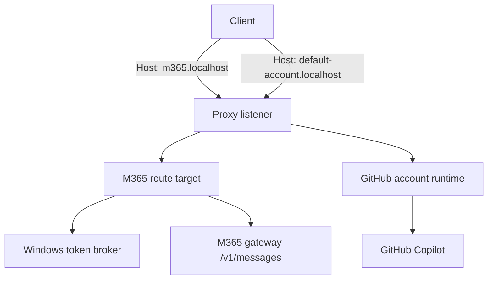
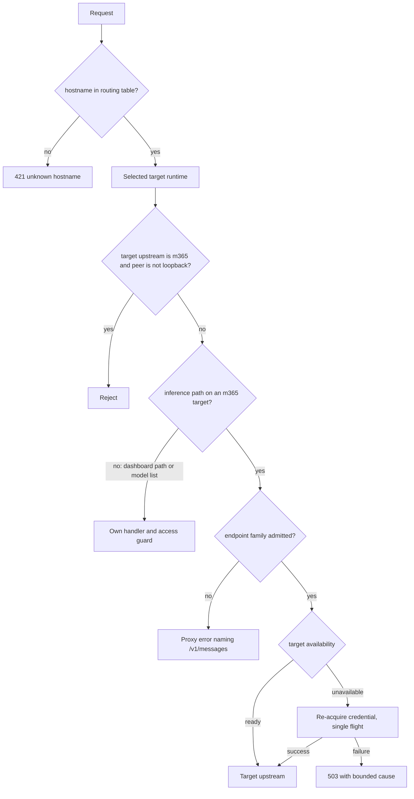

# M365 Copilot as a Coexisting Route Target - Plan

## Goal Capsule

- **Objective:** One ghc-proxy process serves both the GitHub Copilot upstream and the M365 Copilot gateway, and an operator onboards or removes the M365 side from the dashboard without editing files, restarting the process, or running a second instance.
- **Means:** M365 becomes a route target in the existing hostname routing table rather than a process-wide upstream mode.
- **Product authority:** This plan covers the M365 route target and its dashboard surface only. Existing GitHub account management, migration of two-instance setups, and cross-target failover are not active scope.
- **Open blockers:** None.
- **Execution profile:** One pull request, eight units. GitHub account management keeps its current behavior; only the M365 target is new behavior.

## Product Contract

### Summary

Make M365 Copilot a route target that coexists with GitHub accounts in one process and one listener, selected per request by hostname. The dashboard's Accounts view gains an M365 section that onboards the target, shows the routing table and credential health, and hands over the client configuration.

### Problem Frame

An operator who wants both Copilot subscriptions today runs two processes on two ports and maintains hosts entries that point different hostnames at each port. Every client therefore needs two base URLs wired by hand, and the two instances share nothing: separate configuration reads, separate request queues, separate troubleshooting.

The M365 side is also invisible. Its dashboard panel renders only when the process was already started in M365 mode, so the guidance for connecting a client to it lives in repository documentation that an operator reads in a different window from the one where they would act on it.

### Actors

- A1. Operator — onboards, renames, and removes the M365 target from the dashboard.
- A2. Dashboard section — projects target state and runs the registration and removal transactions.
- A3. Proxy request path — resolves a request hostname to a target, its credential, and its model catalog.
- A4. Windows token broker — reached through the `msc-auth` helper; supplies the Microsoft account list and access tokens.

### Requirements

**Route target**

- R1. One process serves GitHub Copilot accounts and the M365 gateway simultaneously, choosing the target from the request hostname.
- R2. M365 is registered under the reserved target name `m365` in the existing hostname routing table, with default hostname `m365.localhost`; the operator can change the hostname and no GitHub account may take the reserved name.
- R3. Each target owns its upstream, credential source, model catalog, and token lifecycle; a request served by one target never uses another target's credential or models.
- R4. Targets are registered and removed at runtime; the operation takes effect immediately for new requests, persists to configuration, and needs no restart.
- R5. Registration and removal are transactional: a failure leaves the routing table, the persisted configuration, and the live targets as they were.

**Failure and endpoint scope**

- R6. The M365 target that cannot obtain a credential is marked unavailable; requests to its hostname return a proxy-level 503 naming the cause while every other target keeps serving.
- R7. The M365 target serves Anthropic Messages endpoints (including count-tokens) and its own model list; Chat Completions and Responses on its hostname return a proxy-level error naming the supported endpoint instead of forwarding a gateway failure. Dashboard paths keep their own access guard and are never refused by this rule.

**Network boundary**

- R8. Requests to the M365 hostname from a non-loopback peer are rejected; GitHub targets keep their current reachability.
- R9. When M365 is the only target, as with `--upstream m365` today, the process still binds `127.0.0.1` only.

**Dashboard**

- R10. The Accounts view shows an M365 section reporting registration state, hostname, broker account, token expiry, served model count, and the most recent failure reason.
- R11. Onboarding lists broker accounts, takes a choice, and registers the target; a failed token acquisition is reported as a warning and does not block registration. A process with no account-management surface reports onboarding as unavailable instead of offering it.
- R12. The section reports the prerequisite chain it checked — Windows platform, helper availability, broker account listing — and names the step that failed.
- R13. The section shows the client configuration for this target: base URL derived from its hostname and the listening port, placeholder auth token, and the catalog's model names.
- R14. The section shows the full routing table (target to hostname) so an operator can tell which base URL reaches which upstream.
- R15. The section offers removal of the M365 target, effective immediately for new requests and persisted; removal is refused for the last remaining target and, when M365 is the default, only after an explicit default change.

**Compatibility**

- R16. `--upstream m365` keeps its current meaning of "M365 only", unchanged for existing single-upstream users.
- R17. The persisted `m365` configuration block (`account`, `upn`) and the existing broker account picker keep their semantics, now carried by the target rather than by the process.

### Key Decisions

- **M365 is a route target in the existing hostname routing table, not a second listener.** Reuses hostname selection that already exists and keeps one port for every client. Governs R1, R2.
- **Failures are isolated per target.** One unusable target must not take down the other upstream. Governs R6.
- **The network boundary is enforced per hostname instead of demoting the whole process to loopback.** Operators who expose GitHub routes on a LAN keep that ability while the personal M365 credential stays local. (session-settled: user-directed — chosen over process-wide loopback bind: preserves existing GitHub LAN reachability) Governs R8, R9.
- **Registration is hot.** A restart would reproduce the friction that motivates the change. Governs R4, R5.
- **A failed token acquisition does not block registration.** The target can exist in an unavailable state with its cause visible, rather than forcing a restart loop before the operator can see the problem. (session-settled: user-directed — chosen over a strict all-checks-pass gate: the operator chose visibility over prevention) Governs R6, R11.
- **Reserved target name `m365` with default hostname `m365.localhost`; the target name is fixed, the hostname is editable.** Follows the existing `*.localhost` account naming. Governs R2.
- **The dashboard surface lives inside the Accounts view as a promoted section.** M365 and GitHub accounts are both route targets, so one routing view beats a second top-level view that splits routing state across two tabs. Governs R10, R14.

### Key Flows

- F1. Register the M365 target
  - **Trigger:** The operator chooses a broker account in the M365 section and confirms.
  - **Actors:** A1, A2, A4
  - **Steps:** List broker accounts; validate the resulting routing table; acquire a token, recording rather than blocking on failure; fetch the model catalog; persist the configuration; install the target; refresh the section.
  - **Outcome:** The target serves its hostname, or it is registered and reports unavailable with a cause.
  - **Covers R4, R5, R10, R11, R12.**
- F2. Resolve a request to a target
  - **Trigger:** A request reaches the listener.
  - **Actors:** A3
  - **Steps:** Read the request hostname; select the target; use that target's credential and model catalog; forward to that target's upstream. An unknown hostname is refused.
  - **Outcome:** The request is served by exactly one upstream, with the other targets untouched.
  - **Covers R1, R3, R7.**
- F3. Handle an unavailable target
  - **Trigger:** The target has no valid credential, or a refresh fails.
  - **Actors:** A3, A2
  - **Steps:** Requests to that hostname return a proxy-level error with the cause; the section marks the target unavailable and shows the reason.
  - **Outcome:** Other targets keep serving; the operator sees why this one does not.
  - **Covers R6, R10.**

### Acceptance Examples

- AE1
  - **Covers R6, R11.**
  - **Given** GitHub routing works and the M365 target was registered while token acquisition failed,
  - **When** a client calls the M365 hostname,
  - **Then** it receives a 503 naming the acquisition failure, and a call to a GitHub hostname still succeeds.
  - **And** once the broker recovers, the next Messages request re-acquires a token and is served.
- AE2
  - **Covers R8.**
  - **Given** the listener is reachable from another machine,
  - **When** a non-loopback peer calls the M365 hostname,
  - **Then** the request is rejected, while the same peer's request to a GitHub hostname is handled as it is today.
- AE3
  - **Covers R4, R5.**
  - **Given** a registration whose configuration write fails,
  - **When** the operation returns,
  - **Then** the live routing table and the persisted configuration are unchanged, and a restart still shows the previous state.
- AE4
  - **Covers R9, R16.**
  - **Given** the process was started with `--upstream m365`,
  - **When** it becomes ready,
  - **Then** M365 is the only target and the listener binds `127.0.0.1` only.
- AE5
  - **Covers R7.**
  - **Given** a client posts to the Chat Completions endpoint on the M365 hostname,
  - **When** the request is handled,
  - **Then** the proxy answers with an error naming the supported Messages endpoint and no upstream call is made.
- AE6
  - **Covers R7, R10, R12.**
  - **Given** the process runs M365 as its only target and the credential is unavailable,
  - **When** the operator opens the dashboard on the M365 hostname,
  - **Then** the dashboard still loads, reports the failure step, and the account picker remains usable.
- AE7
  - **Covers R4, R5.**
  - **Given** a client is streaming through the M365 target,
  - **When** the operator removes the target,
  - **Then** the in-flight stream finishes, new requests to that hostname are refused, and a failed commit leaves the target serving.
- AE8
  - **Covers R15.**
  - **Given** the M365 target is the only target, or is the current default,
  - **When** the operator asks to remove it,
  - **Then** the request is refused with an actionable conflict and nothing changes.
- AE9
  - **Covers R6, R11.**
  - **Given** the broker lists no accounts, or lists accounts that cannot mint a token,
  - **When** the operator opens onboarding,
  - **Then** the empty case offers no registration, and the unlicensed case registers the target as unavailable with its cause.
- AE10
  - **Covers R4, R10.**
  - **Given** two dashboard tabs are open on the same process,
  - **When** one registers the target,
  - **Then** the other shows the committed state on its next refresh, and a stale register from the second tab is refused instead of changing the account.

### Success Criteria

- A machine that runs two instances plus hosts entries today can be reduced to one process, with both hostnames reaching the correct upstream and each client working from its own base URL.
- Onboarding M365 requires no configuration edit and no restart.
- M365 trouble leaves GitHub routing's availability unchanged.

### Scope Boundaries

- **Deferred for later:** guided migration away from two-instance plus hosts-file setups; upstream translation for OpenAI-shaped endpoints on the M365 target; automatic failover or fallback between targets.
- **Outside this product's identity:** a non-Windows credential path for the M365 gateway, including consumer accounts (MSA).

### Dependencies / Assumptions

- Windows is mandatory for the M365 target; the helper is the only credential path.
- The M365 gateway advertises and serves only `/v1/messages`; this is a measured, documented property of the live gateway (`docs/design/m365-upstream.md`), while the code only guarantees it for the static fallback catalog.
- The runtime layer already carries upstream and model catalog per target, so per-hostname upstream selection needs no new runtime concept — verified in `src/state/account-runtime.ts` and `src/clients/factory.ts`.
- Model discovery stays per target, so `/v1/models` naturally reflects the hostname that served it.

### Sources / Research

- `docs/design/m365-upstream.md` — gateway catalog, `/v1/messages`-only surface, loopback rule, account selection precedence.
- `docs/design/dashboard-observability.md` — dashboard scope, account-management transaction, peer-based access guard.
- `src/start.ts` — startup assigns one upstream to the single legacy runtime and the M365-only branch bypasses account routing; no mixed-upstream runtimes are created today.
- `src/state/account-runtime.ts`, `src/clients/factory.ts`, `src/clients/api-config.ts` — per-runtime upstream and model state, and per-upstream header/base-URL branching.
- `src/lib/account-routing.ts`, `src/routes/dashboard/m365.ts`, `src/routes/dashboard/assets.ts` — hostname routing table, the M365-only dashboard projection, and the current hidden panel.
- `CONCEPTS.md` § Routing — hostname account selection vocabulary this work extends.

## Planning Contract

### Product Contract preservation

Changed: R4, R6, R7, R11, R15. R6 is narrowed from "any target" to the M365 target so GitHub's existing fail-fast startup survives. R4 scopes "immediate" to new requests after the commit. R7 exempts dashboard paths and the target's own model list from the inference endpoint gate, without which R10–R15 could not hold. R11 gains the managerless-startup qualifier, which follows the existing unavailable-account-management behavior instead of inventing a second mutation owner. R15 gains the removal preconditions the non-empty-routing and default invariants already force. AE1 gained the recovery step; AE6–AE10 illustrate existing R-IDs. No scope was added.

### Key Technical Decisions

- KTD1. **A credential-less target lives in the existing routing table.** A hostname mapping is the target's only ownership record: `accountRouting.hostnames["m365.localhost"] = "m365"` creates the target, and `compileAccountRouting` admits the reserved name `m365` without a `credentials.json` entry while rejecting a GitHub account that tries to take it. The reserved name is also refused at credential creation, because the compiler only validates configuration. One authority for routing beats a second config block that could disagree with the table. Covers R2.
- KTD2. **One target-runtime factory serves every runtime allocation.** Startup, the dashboard's new-GitHub-account device-auth flow, and M365 registration all obtain runtimes from the same factory, which sets `auth.upstream` with the target's credential identity and model catalog. Covers R1, R3, R4.
- KTD3. **Availability is per-target state, not a thrown error.** A process-local registry records `ready` or `unavailable` with a bounded cause per target. Startup acquisition and request-time re-acquisition both write it, so an expiry that fails mid-traffic surfaces as a 503 rather than a generic 500, and a model-cache miss on an unavailable target never retries GitHub credentials. An unavailable M365 target still re-attempts acquisition through the helper's existing single-flight path on the next Messages request, so a recovered broker returns the target to service without a restart or a background retry loop. Covers R6.
- KTD4. **Only the M365 target degrades.** A failing GitHub routed account keeps today's fail-fast startup; the isolation in R6 is the M365 target's. Covers R6.
- KTD5. **The network boundary is enforced at the routing wrapper, keyed on the selected target's upstream.** A shared `resolveRequestPeer(request, bunServer)` helper returns `{ address?, live }`: Bun reads `server.requestIP(request)`, Node reads the srvx request's `ip` only when its runtime is Node, and an in-process request is not live. After runtime selection and before dispatch, a non-loopback peer is rejected when the selected runtime's upstream is `m365`; a live runtime with no address fails closed. Keying on the target's upstream rather than the literal hostname closes the gap where the M365 target also answers the base hostname and `127.0.0.1` aliases. The dashboard keeps its own hostname and Origin policy. Covers R8, R9.
- KTD6. **Inference admission happens once, in the routing wrapper.** For an `m365` target, a request to an endpoint family other than Messages/count-tokens returns the proxy-level error before any strategy selection or upstream call. Dashboard paths and the target's model list are not inference and pass through to their own handlers. Covers R7.
- KTD7. **Registration and removal reuse the account-manager mutation lock and journal.** The dashboard calls new manager methods instead of writing `m365` config directly. The manager validates the next routing table, writes the routing block and the `m365` identity inside one journal transaction, installs or disposes the runtime, and rolls back on failure. Removal commits before disposing, so an in-flight stream finishes on the runtime it started with. Covers R4, R5, R15, R17.
- KTD8. **Dashboard projections read the committed routing snapshot, not the request-current runtime.** State is built from the manager's committed snapshot and the availability registry, so opening the dashboard on a GitHub hostname still reports the M365 target, and a viewer never sees a target that a later rollback removes. Health fields are cached, broker listing is an explicit action, and the Live refresh fetches only the cached projection. Covers R10, R11, R12.
- KTD9. **`--upstream m365` becomes a shorthand for a routing table holding only that target.** It keeps the loopback bind because the M365 target is then the only target. Covers R9, R16.
- KTD10. **The credential identity is the full `{exe, account, upn}` triple.** Startup acquisition and every later refresh pass the same triple through the runtime's auth store and client config, with `account` keeping precedence over `upn` as the helper already implements. Distinct identities keep distinct cached tokens. Covers R3, R17.

### High-Level Technical Design

Registration runs the same shape in reverse: the manager validates the next table, journals, persists, installs the runtime, and only then publishes the routing snapshot the dashboard reads.

### Risks and Dependencies

- The peer gate depends on the runtime adapter exposing a peer address. The dashboard guard proves both runtimes today; the shared helper keeps that behavior in one place, and the extraction must move `isLoopbackAddress` with it rather than leaving a re-export shim.
- `msc-auth` exists only on Windows; on other platforms the target must report unavailable, never fail startup.
- The M365 gateway's Messages-only surface is measured evidence (`docs/design/m365-upstream.md`), not a code guarantee; KTD6 makes the proxy state it explicitly.
- A hand-edited `config.json` still takes effect only at restart. Dashboard mutations replace the routing block they own, so an operator who edits the file while the process runs must restart before further dashboard mutations.

### Alternatives Considered

- **A second listener per upstream.** Rejected: it preserves the two-base-URL arrangement the work exists to remove.
- **Path-prefix routing (`/m365/v1/messages`).** Rejected: the operator chose hostname discrimination, and the routing table already speaks hostnames.
- **A separate `m365.hostname` config block.** Rejected: two authorities for one routing table drift.

### Assumptions

- The `msc-auth` token cache is already keyed per identity (`exe`, `account`, `upn`, `tenant`), so multiple M365 targets need no new cache.
- A GitHub account named `m365` does not exist in any live deployment; validation rejects it from now on.
- The request path keeps reading the ALS-selected runtime's upstream; `messages/shared.ts` and `model-rewrite.ts` already branch per runtime and are not rewritten into process-wide switches.

## Implementation Units

Ships as one pull request; units are ordered by dependency.

### U1. Admit a credential-less target in routing configuration

- **Goal:** Routing configuration can name the reserved `m365` target and the compiler admits it without a GitHub credential.
- **Requirements:** R2, R17
- **Origin coverage:** F1 (validate the resulting routing table); F2 (hostname-to-target selection).
- **Dependencies:** None
- **Files:** `src/lib/account-routing.ts`, `src/lib/config.ts`, `src/lib/credentials.ts`, `tests/account-routing.test.ts`, `tests/config-state.test.ts`
- **Approach:**
  - Give compiled routing an explicit target kind so downstream code stops inferring upstream from a process-wide value.
  - Admit `m365` in `compileAccountRouting` without a credentials entry; reject any GitHub account that claims the reserved name, and refuse creating a credential under that name.
  - Keep `m365.account` and `m365.upn` as the target's credential identity, unchanged in meaning.
- **Patterns to follow:** the existing fail-closed validation in `compileAccountRouting`; the account-name selection in `src/lib/credentials.ts`.
- **Test scenarios:**
  - A hostname map containing `m365.localhost` → `m365` compiles with no `credentials.json` entry.
  - A GitHub account named `m365` is rejected by the compiler with a message naming the reserved name.
  - Writing a GitHub credential under the reserved name is refused.
  - Routing with an `m365` config block but no hostname mapping registers no target.
  - Existing validation failures (duplicate hostname, missing default) behave as before.
- **Verification:** a credential-less `m365` mapping compiles; the reserved name is refused at both the compiler and the credential writer; duplicate-hostname and missing-default errors are unchanged.

### U2. Build target runtimes and track per-target availability

- **Goal:** One factory builds a runtime for any target, and the M365 target reports readiness instead of throwing at its callers.
- **Requirements:** R1, R3, R6, R17
- **Origin coverage:** F1 (credential acquisition and catalog initialization); F2 (target-owned credential and catalog); F3 (availability state); AE1 (registration may retain an unavailable target).
- **Dependencies:** U1
- **Files:** `src/accounts/target-runtime.ts` (new), `src/accounts/device-auth.ts`, `src/state/account-runtime.ts`, `src/state/auth.ts`, `src/clients/types.ts`, `src/clients/factory.ts`, `src/clients/copilot-client.ts`, `tests/target-runtime.test.ts`
- **Approach:**
  - Factory takes a target name and options and returns an `AccountRuntime` with `auth.upstream` and the full credential identity set for that target; the device-auth completion path allocates GitHub runtimes through it too.
  - For `m365`, acquire a token through the existing helper client, fetch the catalog with the static list as fallback, and cache it on the runtime's own model cache.
  - Record `ready`/`unavailable` with a bounded cause in a process-local registry that resets with the account runtimes, and update it from request-time re-acquisition as well as startup.
  - Carry `upn` through the auth store and client config to the helper, keeping `account` precedence.
- **Patterns to follow:** `createAccountRuntime` in `src/state/account-runtime.ts`; catalog fetch and normalization in `src/clients/m365-upstream.ts`; identity keying in `src/clients/msc-auth.ts`.
- **Test scenarios:**
  - A GitHub target builds exactly what startup builds today.
  - An M365 target carries `upstream: 'm365'`, the `{exe, account, upn}` identity, and the fetched catalog.
  - A catalog failure falls back to the static list and the target stays ready.
  - A token failure at startup marks the target unavailable with the helper's diagnostic and does not throw.
  - A refresh failure during a request flips the target to unavailable with the cause.
  - The M365 target's models are invisible through a GitHub runtime's cache.
- **Verification:** the factory's result asserts upstream, identity, catalog, and registry state for each outcome, including the request-time failure path.

### U3. Wire startup for coexisting targets

- **Goal:** Startup builds GitHub runtimes plus the configured M365 target, and `--upstream m365` still works as a shorthand.
- **Requirements:** R1, R9, R16
- **Origin coverage:** F2 (assemble coexisting target runtimes); F3 and AE1 (M365 initialization failure does not abort GitHub startup); AE4 (M365-only startup and loopback bind).
- **Dependencies:** U1, U2
- **Files:** `src/start.ts`, `src/cli/startup-banner.ts`, `src/selfcheck.ts`, `scripts/smoke/packaged-cli.ts`, `tests/account-routing-runtime.test.ts`
- **Approach:**
  - Replace the `upstream === 'm365'` startup branch with target assembly from the compiled routing table.
  - `--upstream m365` synthesizes a table containing only the M365 target; the listener binds `127.0.0.1` only when that target is the only target.
  - GitHub account initialization keeps its current fail-fast behavior (KTD4). The exported `authStore` is already an ALS-scoped facade, so the migration is about deleting the startup-wide assignment and scoping non-request projections, not about rewriting request readers.
  - The startup banner reports one target's upstream, catalog, fallbacks, and URL together, and exposes the bound port for the dashboard projection.
- **Patterns to follow:** the current routed-account startup loop and its ALS-scoped initialization; the dashboard-boundary probe in `src/selfcheck.ts` for a real-listener check.
- **Test scenarios:**
  - A mixed configuration starts with both a GitHub runtime and the M365 target.
  - `--upstream m365` alone still binds loopback and serves only that target.
  - An M365 target that cannot acquire a token leaves the GitHub target serving.
  - A configuration without an M365 target behaves exactly as before, including fail-fast on a bad GitHub credential.
  - The packaged probe covers M365-only startup under both Bun and Node.
- **Verification:** mixed startup installs two runtimes; a failing M365 target still leaves GitHub requests succeeding; M365-only startup binds `127.0.0.1` and reads no GitHub credential.

### U4. Enforce peer, endpoint, and availability gates per target

- **Goal:** A request to the M365 target is bounded by network origin, endpoint family, and target availability; other targets are unaffected.
- **Requirements:** R6, R7, R8
- **Origin coverage:** F2; F3; AE1 (503 with acquisition cause and GitHub isolation); AE2 (peer restriction); AE5 (endpoint refusal without an upstream call); AE6 (dashboard reachable while unavailable).
- **Dependencies:** U2
- **Files:** `src/lib/peer.ts` (new), `src/server.ts`, `src/state/account-runtime.ts`, `src/routes/dashboard/route.ts`, `tests/account-routing-runtime.test.ts`, `tests/dashboard-route.test.ts`
- **Approach:**
  - Extract a shared `resolveRequestPeer(request, bunServer)` returning `{ address?, live }`: Bun uses `server.requestIP(request)`, Node uses the srvx request's `ip` only when its runtime is Node, and an in-process request reports not live. Move `isLoopbackAddress` and its normalization with it and update importers.
  - Give the routing wrapper access to the Bun server so the gate sees the same peer data the dashboard does.
  - After runtime selection, every request on an `m365` target passes the peer check first; an unavailable target re-attempts acquisition once through the helper's single-flight path before answering 503.
  - Only inference requests are subject to endpoint admission and the availability gate. Dashboard paths and the target's model list continue to their own handlers, and the dashboard keeps its own access guard.
  - Leave the existing 421 unknown-host path and the GitHub dispatch path untouched.
- **Patterns to follow:** `accountRoutingWrapper` in `src/server.ts`; `rejectDashboardAccess` and its peer resolver in `src/routes/dashboard/route.ts`.
- **Test scenarios:**
  - A non-loopback peer is rejected on the M365 target and served on a GitHub target, under both peer resolutions.
  - A live peer with no resolvable address is rejected for the M365 target.
  - The base hostname and the `127.0.0.1` alias are gated when the M365 target is the default.
  - Chat Completions and Responses on the M365 target return the proxy error naming `/v1/messages`, with no upstream call.
  - Dashboard and model-list requests on the M365 hostname pass the peer check but are not refused by endpoint admission or availability.
  - An unavailable target that recovers answers 200 on the next Messages request and reports ready; one that fails again returns 503 with its recorded cause.
  - Unknown hostnames still return 421.
- **Verification:** on a real Bun and Node listener, non-loopback peers get 403 for the M365 dedicated hostname and its aliases while GitHub requests still reach their handler; refused endpoints report 400 with `/v1/messages` named and an upstream call count of zero; an unavailable Messages request returns the protocol error envelope with status 503.

### U5. Register and remove the M365 target transactionally

- **Goal:** The M365 target can be added, changed, and removed at runtime, persisted, and rolled back on failure.
- **Requirements:** R4, R5, R15, R17
- **Origin coverage:** F1 (transactional registration and installation); AE1 (failed token acquisition is not a failed registration); AE3 (failed persistence preserves live and restarted state); AE7 (in-flight stream survives removal); AE8 (last-target and default removal preconditions).
- **Dependencies:** U1, U2
- **Files:** `src/accounts/manager.ts`, `tests/account-manager.test.ts`
- **Approach:**
  - Add manager methods for register, remove, and account/hostname change, all running inside the existing mutation lock and journal.
  - Extend the persistence seam so one journal transaction writes both the routing block and the `m365` identity; clone/convert helpers must preserve the new target kind and keep the GitHub-account snapshot separate from the full target routing snapshot.
  - Validate the complete next routing table before writing; install the runtime through the U2 factory after persistence succeeds; restore the previous routing and runtimes on any failure.
  - Publish the new routing snapshot only after the commit, so a reader never sees an uncommitted target; removal commits before disposing, leaving in-flight streams to finish.
  - Refuse removal of the last target and of a default M365 target until another default is chosen.
  - When the process started without an account manager (process-wide GitHub token, a GHE override, or a legacy multi-account store without routing), target mutations are unavailable: the seam reports the existing unavailable condition rather than inventing a second mutation owner, and the persisted target still loads at the next startup.
- **Patterns to follow:** `setDefaultAccount` and `addAccount` completion paths, including their rollback branches and conflict guards.
- **Test scenarios:**
  - Registration persists the hostname mapping and installs a serving runtime.
  - A persistence failure rolls back config bytes, routing, runtime identity, and availability.
  - Removal rolls back the same way when persistence fails, and an in-flight stream completes when it succeeds.
  - Removing the last target, or a default target, is refused with an actionable conflict and no state change.
  - An account change installs a new runtime; an acquisition failure leaves the target unavailable without falling back to the previous account.
  - Concurrent register and default-switch operations serialize without interleaving.
  - Restart after a committed registration reads the target back; a hand-edited hostname takes effect only after restart.
- **Verification:** disk routing and identity, the manager snapshot, and request routing agree after each mutation; injected failures restore all three to the pre-operation state and a restart reads the old state.

### U6. Expose M365 target state and mutations on the dashboard API

- **Goal:** The dashboard can report the target's full state and drive registration, removal, hostname change, and account change.
- **Requirements:** R10, R11, R12, R13, R15
- **Origin coverage:** F1 (account listing, registration API, refreshed projection); F3 (unavailable state and cause); AE1 (successful registration with an acquisition warning); AE6 (dashboard readable while the target is unavailable).
- **Dependencies:** U2, U3, U5
- **Files:** `src/routes/dashboard/route.ts`, `src/routes/dashboard/m365.ts`, `src/routes/dashboard/handler.ts`, `src/routes/dashboard/assets.ts` (contract only), `src/server.ts`, `tests/dashboard-route.test.ts`
- **Approach:**
  - Replace the `enabled: false` projection with committed-snapshot state: registration, hostname, account, token expiry, served model count, model names, availability cause, readiness results, and the full target-to-hostname routing rows.
  - Build the client base URL from the registered hostname and the bound listener port, never from the dashboard request's hostname.
  - Add strict zod schemas for the mutation endpoints and route every write through the manager; a duplicate register is a conflict, not an account change.
  - Make the prerequisite probe (platform, helper resolvable, broker accounts listable) an explicit action, and pass UI asset constants through without changing them here.
  - In the managerless startup state, the projection marks onboarding unavailable with that reason and mutations return the existing 409 response, while a target configured in the file is still reported.
  - Keep GitHub identity, tenant, and quota projections on GitHub descriptors only, and derive the Behavior fallbacks from the selected target's upstream.
- **Patterns to follow:** existing account POST handlers, `apiResponse`/`apiError`, and the `.strict()` schema convention.
- **Test scenarios:**
  - GET on a process running only the GitHub upstream reports the M365 target as absent rather than hiding it.
  - A registered-but-unavailable projection carries its cause and still serves the account picker.
  - Registering with a failing token returns success with a warning.
  - A duplicate register returns a conflict and changes nothing.
  - Remove and hostname change return the new committed projection.
  - Unknown request fields are rejected with the standard error envelope.
  - The readiness probe names the failing prerequisite step.
  - Repeated GET requests call no helper and write no config.
- **Verification:** projections come only from the committed snapshot; the base URL matches the registered hostname and bound port; mutations return the post-commit projection; the guard's cross-origin and remote-peer tests still pass.

### U7. Promote the M365 section in the Accounts view

- **Goal:** The Accounts view carries the onboarding and management surface described in R10–R15.
- **Requirements:** R10, R11, R12, R13, R14, R15
- **Origin coverage:** F1 (operator onboarding and refreshed section); F3 and AE1 (visible unavailable state and acquisition warning); AE9 (empty and unlicensed broker states); AE10 (two tabs converge on committed state).
- **Dependencies:** U6
- **Files:** `src/routes/dashboard/assets.ts`, `tests/dashboard-assets.test.ts`
- **Approach:**
  - Turn the hidden panel into a section that renders both states: absent with onboarding, present with status, hostname, account picker, routing table, and client snippet.
  - Derive the snippet, routing rows, and port from the API payload; the client invents nothing.
  - Keep the Live refresh read-only and add the cached M365 projection to it; broker listing and the readiness probe stay behind explicit actions.
  - Refresh status text without rebuilding a form the operator is editing.
- **Patterns to follow:** existing tab/panel structure, `fetchJson`, snapshot dedupe, and `textContent` rendering in `assets.ts`.
- **Test scenarios:**
  - The section renders onboarding when the target is absent, with no registration control when the broker lists no accounts.
  - The snippet matches the payload's hostname, port, and model names.
  - The managed state shows routing rows for every target.
  - A failed mutation renders the cause as text and re-enables the control.
  - Live refresh performs no POST and no broker probe.
  - A status refresh preserves an in-progress account or hostname selection.
  - An unlicensed account registers, and the section shows the unavailable cause.
- **Verification:** the asset VM tests assert both DOM states, payload equality for the snippet, absence of POST traffic across Live ticks, and preserved in-progress input; one manual dashboard load covers the absent and registered states.

### U8. Document the target model

- **Goal:** Design docs, glossary, and README describe coexisting targets instead of a process-wide upstream switch.
- **Requirements:** R16, R17
- **Documented contracts:** F1–F3 and AE1–AE10; behavioral enforcement remains in U1–U7.
- **Dependencies:** U3, U6
- **Files:** `docs/design/m365-upstream.md`, `docs/design/dashboard-observability.md`, `docs/design/state-and-config.md`, `docs/design/architecture-overview.md`, `docs/design/model-routing.md`, `docs/design/README.md`, `CONCEPTS.md`, `README.md`
- **Approach:**
  - Replace the "selected with `--upstream m365`" framing with the target model: reserved name, hostname mapping as the registration authority, per-target credential/catalog/availability, peer gate, inference admission, dashboard transactions, and the M365-only loopback shorthand.
  - Record `route target` in the glossary under Routing and extend the hostname-selection entry to name upstream-specific credentials.
  - Correct `model-routing.md`, which currently describes family fallbacks as Chat-adapter only while M365 maps families before strategy selection.
- **Test expectation:** none — documentation only. Verification is that no statement contradicts KTD1–KTD10.
- **Verification:** a read-through of the changed docs confirms the target model and removes every description of M365 as an exclusive process mode.

## Verification Contract

| Gate | Command | Covers |
| --- | --- | --- |
| Targeted unit tests | `bun test tests/account-routing.test.ts tests/config-state.test.ts tests/target-runtime.test.ts tests/account-manager.test.ts tests/account-routing-runtime.test.ts tests/dashboard-route.test.ts tests/dashboard-assets.test.ts tests/msc-auth.test.ts tests/m365-upstream.test.ts` | U1–U7 |
| Full suite | `bun test` | Regression safety |
| Lint | `bun run lint:all` | Repo style gates |
| Types | `bun run typecheck` | Strict TypeScript |
| Build | `bun run build` | Bundled dashboard assets and dynamic chunks |
| Packaged runtime | `bun run smoke:packaged` | Bun and Node CLI children, including the new M365 coexistence probe |
| Live behavior | Start the proxy with a mixed routing config | Per-hostname model lists, peer rejection, inference admission, 503 cause |

## Definition of Done

- Every unit's test scenarios pass, and the targeted suite plus `bun test` are green.
- `bun run lint:all`, `bun run typecheck`, `bun run build`, and `bun run smoke:packaged` pass, with both runtime children executing the new probe.
- On a real listener, both hostnames serve their own model lists; GitHub requests are unaffected; non-loopback peers get 403 on the M365 hostname and its aliases; Chat Completions and Responses on that hostname return the documented error with no upstream call; an unavailable target returns 503 with its cause while the dashboard still loads and manages it.
- Register, hostname change, account change, and removal complete without a restart, commit atomically, and roll back cleanly on injected failure.
- No dead-end code from abandoned approaches remains; temporary fixtures are removed.
- Docs and `CONCEPTS.md` describe the target model and match the shipped behavior.
