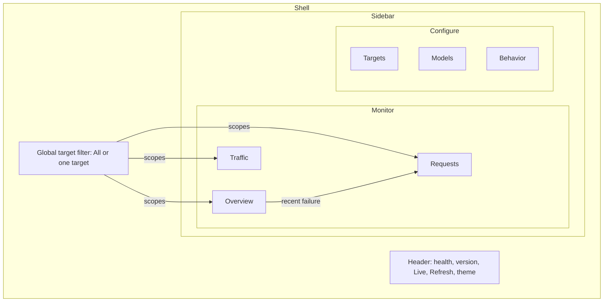
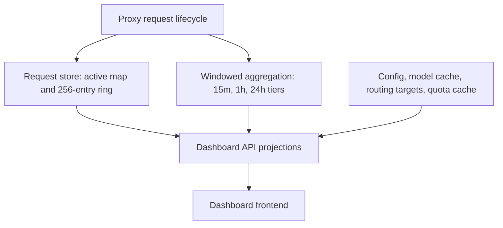
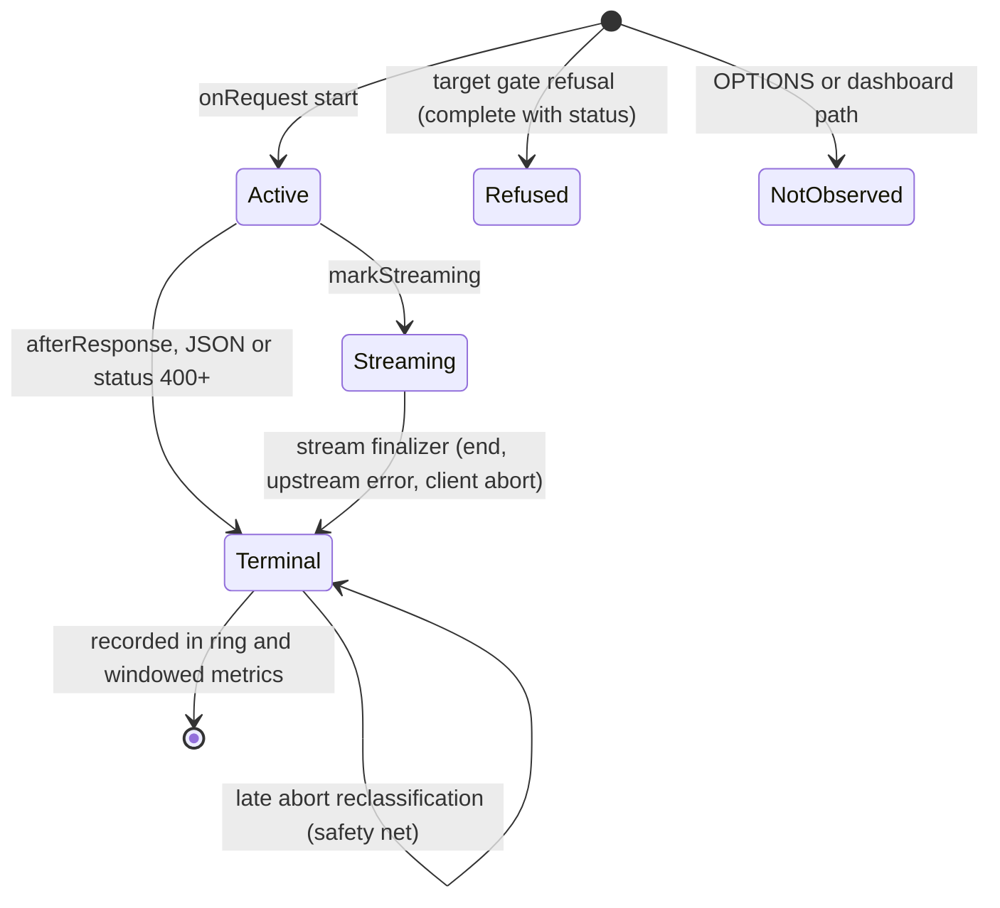
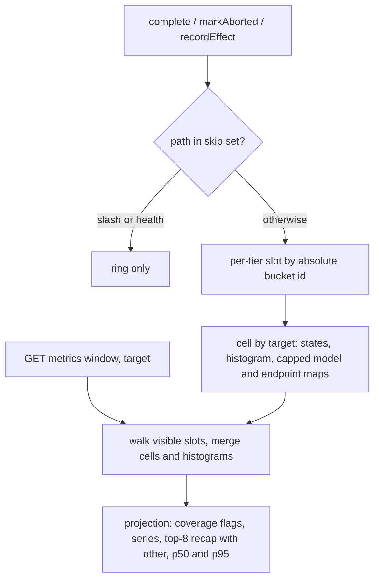
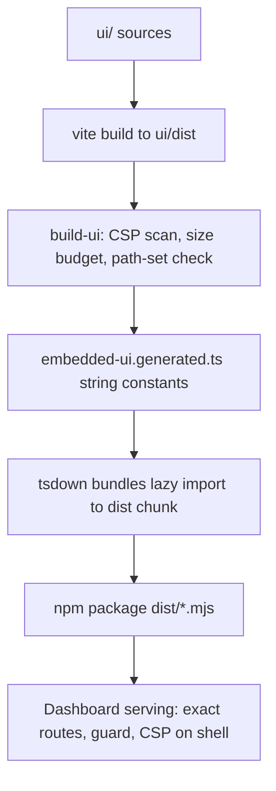
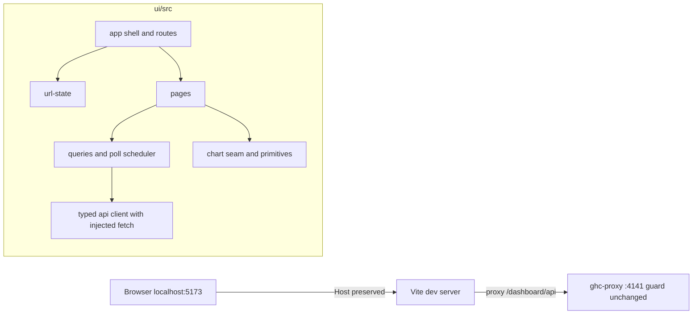

# Dashboard Redesign - Plan

## Goal Capsule

- **Objective:** An operator running ghc-proxy can open the built-in Dashboard and immediately tell whether the proxy is healthy, what happened in the last minutes to hours, and which target, model, or endpoint is responsible, then manage route targets from the same place. Contributors can change the Dashboard as quickly as any other typed part of the codebase.
- **Means:** Rewrite the Dashboard on a modern typed frontend stack with a reorganized information architecture and a new visual design, and add an in-memory, time-windowed metrics aggregation on the server. Both ship in one delivery. (KTD3, KTD6, KTD7)
- **Authority hierarchy:** The Product Contract wins on behavior. Key Technical Decisions win on mechanism within their cited requirements. Units and the Verification Contract never amend either. Decisions marked `session-settled` were chosen by the user against the named alternatives.
- **Execution profile:** One PR on `feat/refine-dashboard`, as the user directed ("deliver together"). Units run in dependency order. U1 and U4 open with a spike or characterization gate that can change later units.
- **Stop conditions:** Stop and report if a spike shows a session-settled decision cannot work (for example the strict CSP cannot be met by any chart library, including the pre-decided SVG fallback), if the initial JavaScript cannot fit the hard budget in KTD17, or if stream-end completion cannot be made reliable on Node. First-chunk completion is not an acceptable replacement for AE11.
- **Finishes and ships:** The `lfg` pipeline implements, simplifies, reviews, commits, pushes, and opens the PR. Merging is not authorized.
- **Open blockers:** None.

---

## Product Contract

**Product Contract preservation:** changed: AE1 restated (its premise does not occur in production startup; the intended behavior is kept) and AE9-AE11 added (acceptance examples for behavior the planning research found unspecified). R-IDs, Key Decisions, and Scope Boundaries are unchanged. The Outstanding Questions are resolved by the Planning Contract and removed.

### Summary

The Dashboard becomes a standalone typed frontend project built with a modern component framework, embedded into the existing npm package, and served at `/dashboard` under the existing security boundary.
Navigation moves to a left sidebar with Monitor and Configure groups, a global route target filter, and a separate URL for every page.
A new in-memory aggregation powers trend charts and breakdowns over 15-minute, 1-hour, and 24-hour windows.

### Problem Frame

The current Dashboard works, but it is visually rough, and its layout follows the shape of the backend data instead of the questions an operator asks.
It shows only a point-in-time snapshot plus the last 256 requests, so it cannot answer "did something break a few minutes ago" or "which model or account is slow".

The code makes the problem self-reinforcing.
`src/routes/dashboard/assets.ts` holds about 1,500 lines of HTML, CSS, and JavaScript as three `String.raw` constants with no types, no components, and one global mutable state object.
The asset tests run a sliced prefix of that string inside `node:vm` with a hand-built fake DOM.
Every UI change means reading a large untyped string and updating pinned ids and copy, so the UI stays "functional but ugly" because iterating on it is slow.

### Actors

- A1. Operator: the local user running ghc-proxy who watches health and traffic and manages route targets.
- A2. Contributor: a developer changing the Dashboard who needs a fast, typed, testable edit loop.

### Key Decisions

- **Full modern frontend stack.** A component framework, a styling system, and a chart library, built by a frontend toolchain whose output is embedded in the package. Governs R1, R2, R7. (session-settled: user-directed — chosen over Preact with signals and over zero-dependency vanilla TypeScript modules: iteration speed and visual quality matter more than staying dependency-free.)
- **Reorganize the information architecture and add new visualizations.** Governs R9–R19, R20–R26. (session-settled: user-directed — chosen over a pure reskin with page parity and over an IA reorganization with no new data: the current snapshot-only views cannot answer recent-history questions.)
- **Visualizations cover traffic and health trends, latency distribution, and breakdowns by model, target, and endpoint, not token usage.** Governs R15, R21. (session-settled: user-directed — token usage was offered and not selected; the design doc's "no token statistics" boundary stays.)
- **Sidebar with Monitor and Configure groups plus a global target filter.** Governs R9, R11. (session-settled: user-directed — chosen over a grouped sidebar without a filter, four top tabs with all charts on Overview, and a target-centric switcher with a Settings page: the user picked the hybrid of the grouped sidebar and the target filter after seeing sketches.)
- **Friendly product visual style.** Large type, generous spacing, soft surfaces, in the spirit of Stripe or Raycast, with light and dark themes. Governs R27. (session-settled: user-directed — chosen over a restrained Linear/Vercel tool style and a dense Grafana/Datadog monitoring style.)
- **Three metric windows: 15m at 10s buckets, 1h at 1m buckets, 24h at 15m buckets.** Governs R20. (session-settled: user-directed — chosen over a single 1h/1m window and a single 24h/5m window.)
- **Deliver frontend and metrics together.** Governs the delivery shape; planning orders the work by dependency but produces one shippable change. (session-settled: user-directed — chosen over one plan with two phases shipped separately and over frontend-only with metrics brainstormed later.)
- **Keep the strict CSP unchanged.** No inline script or style and no eval, so libraries that inject `<style>` at runtime are excluded. Governs R4. (session-settled: user-approved — accepted with the synthesis.)
- **Metrics stay in process memory and content-free.** They reset on restart and record no tokens or request content. Governs R20, R23. (session-settled: user-approved — accepted with the synthesis; this narrows rather than removes the design doc's "not an analytics system" boundary.)
- **Remove the legacy UI with no toggle.** Governs R1. (session-settled: user-approved — accepted with the synthesis; frontend tests and selfcheck probes that pin legacy ids and copy are rewritten.)
- **Bound the model dimension.** The effective model is the last transform target or the client-supplied model when no transform applies, so its distinct values are not limited by the upstream catalog. Governs R22.
- **Approximate percentiles.** p50 and p95 come from bucketed latency distributions rather than exact per-request samples. Governs R21.

### Requirements

**Frontend foundation and delivery**

- R1. The Dashboard UI is rebuilt as a standalone typed frontend project in this repository, and the legacy embedded HTML/CSS/JS UI is deleted.
- R2. The built frontend ships inside the existing npm package and is served by the proxy at `/dashboard` without reading files at runtime, so consumers need no extra install or build step.
- R3. The Dashboard works when only the selected runtime (Bun or Node.js) is installed, and `smoke:packaged` verifies it under both.
- R4. The Dashboard runs under the existing strict self-only Content Security Policy with no external resources, fonts, or CDNs.
- R5. The existing access boundary holds for every Dashboard asset and API route: a loopback peer, a loopback hostname, and a same-origin `Origin`. Runtime values are never rendered as raw HTML.
- R6. A contributor can run the Dashboard with hot reload against a running proxy and real data, while the production `Origin` guard stays as strict as it is today.
- R7. The frontend consumes typed API contracts shared with the server projections, so a projection change that breaks the UI fails typecheck.
- R8. Frontend lint, typecheck, tests, and build run in CI and in the documented local full gate.

**Navigation and information architecture**

- R9. A left sidebar groups pages into Monitor (Overview, Traffic, Requests) and Configure (Targets, Models, Behavior).
- R10. Every page has its own URL. Reloading, back/forward, and bookmarks restore the page together with its target filter, time window, and selected request.
- R11. A global route target filter, defaulting to All, scopes the Monitor pages and is hidden when only one target exists.
- R12. A persistent header shows health status and version, plus controls for Live polling, manual metadata Refresh, and theme.
- R13. The layout stays usable at narrow widths, with the sidebar collapsing into a menu.

**Pages**

- R14. Overview shows a KPI row (health, request rate, error rate, p95 latency, active requests and queue), traffic and latency trends for the selected window, a health card per target (authentication, quota, cooldown), and recent failures that link to their Requests detail.
- R15. Traffic shows requests by terminal state over time, p50/p95 latency over time, and request and failure counts broken down by model, target, and endpoint, with a 15m/1h/24h window selector.
- R16. Requests lists active requests and the most recent 256 terminal requests, filterable by state, endpoint, model, and target. The selected request's detail is a structured view of its model transform trace, strategy, effects, and error summary rather than raw JSON.
- R17. Targets presents GitHub accounts and the M365 target in one table, preserves every existing management action, and shows a client configuration snippet for each target.
- R18. Models preserves the current model metadata, routing and compatibility projection, filtering, vendor grouping, sorting, and multi-select copy.
- R19. Behavior shows current routing, parameter, and context configuration, and effect counts for the selected window alongside since-startup totals.

**Windowed metrics**

- R20. The server keeps an in-memory, time-bucketed aggregation at three tiers (15 minutes in 10-second buckets, 1 hour in 1-minute buckets, 24 hours in 15-minute buckets). It is never persisted, starts empty after a restart, and charts state when collection began.
- R21. Each bucket records request counts by terminal state, a latency distribution sufficient for approximate p50 and p95, and per-model, per-target, and per-endpoint request and failure counts.
- R22. The number of distinct model values per tier is capped, and values beyond the cap are counted under a single "other" entry.
- R23. Metrics contain only dimension values that already pass the request store's sanitization, and never request or response content, tokens, headers, or caller request IDs.
- R24. Dashboard traffic is excluded from metrics, as it is excluded from the request ring today.
- R25. Effect counters are recorded per window in addition to the existing since-startup totals.
- R26. Recording metrics adds constant-time work per request on the proxy path. Aggregation and querying happen only when the Dashboard asks.

**Experience quality**

- R27. The visual design follows the friendly product style in light and dark themes, follows the system theme by default, and persists the user's choice.
- R28. Every data region has distinct loading, empty, stale or unavailable, and error states. One region's failure never blanks the rest of the page.
- R29. Mutations show inline progress and outcome. Removing a target requires a confirmation that names it.
- R30. Live polling refreshes only the current page's data, pauses while the tab is hidden, and never triggers the metadata refresh POST or M365 broker discovery.
- R31. Pages are keyboard navigable with visible focus. Chart values are readable from hover or focus and from an accessible numeric equivalent.

### Information Architecture



### Data Flow



### Key Flows

- F1. Investigate a recent problem
  - **Trigger:** The operator notices failures or slowness in a client.
  - **Actors:** A1
  - **Steps:** Open Overview and see the error-rate or latency spike in the trend. Narrow it with the target filter or open Traffic to see which model or endpoint drives it. Click a recent failure to open its structured Requests detail.
  - **Covered by:** R10, R11, R14, R15, R16
- F2. Add a GitHub account
  - **Trigger:** The operator wants another account routed by hostname.
  - **Actors:** A1
  - **Steps:** Open Targets, enter a name, hostname, and optional GHE tenant, complete the device-code login with progress shown inline, then see the new target in the table with its client snippet.
  - **Covered by:** R17, R29
- F3. Set up the M365 target
  - **Trigger:** The operator wants M365 Copilot served next to GitHub accounts.
  - **Actors:** A1
  - **Steps:** In Targets, check prerequisites, see which step failed if any, sign in or choose a broker account, set the hostname, and register. The M365 row then appears in the same target table.
  - **Covered by:** R17, R28, R29
- F4. Change a Dashboard panel
  - **Trigger:** A contributor wants to add or adjust a panel.
  - **Actors:** A2
  - **Steps:** Start the proxy and the frontend dev loop, edit a typed component, and see the change hot-reload against live data. Typecheck flags any mismatch with the server projection.
  - **Covered by:** R6, R7, R8

### Acceptance Examples

- AE1. Covers R11, R17. **Given** a process with no route targets and no account manager (a single credential or an override flag), **when** the operator opens the Dashboard, **then** the target filter is hidden, Monitor pages show all traffic, and Targets shows the single implicit target read-only with no bootstrap action. **Given** an account manager whose routing is not enabled (test and selfcheck setups), **then** Targets offers the routing bootstrap action.
- AE2. Covers R10. **Given** the operator is on Traffic with target `work`, the 1h window, and a request selected on Requests, **when** they reload or open a bookmarked URL, **then** the same page, target, window, and selection are restored.
- AE3. Covers R20, R28. **Given** the proxy restarted two minutes ago, **when** the operator selects the 24h window, **then** charts show only data since process start and say when collection began, instead of rendering an empty 24 hours as zero traffic.
- AE4. Covers R22. **Given** clients sent more distinct model names than the cap within a window, **when** the operator views the model breakdown, **then** the extra models appear under a single "other" entry and the totals still match.
- AE5. Covers R11, R14. **Given** the target filter is set to the M365 target, **when** the operator views Overview, **then** the KPIs, trends, and recent failures reflect only M365 requests and only the M365 health card is shown.
- AE6. Covers R28, R30. **Given** the quota projection for one account fails, **when** Live polling runs, **then** that account's quota shows as unavailable or stale while the rest of the page keeps updating, and the error clears once that source succeeds.
- AE7. Covers R5, R6. **Given** a browser page from a different origin, including the frontend dev server's origin, **when** it calls a production Dashboard API route directly, **then** the proxy returns 403.
- AE8. Covers R17, R29. **Given** the operator opened the Dashboard on the hostname of a non-default account, **when** they confirm removing that account, **then** the browser is redirected to the surviving base hostname on the same port, as today.
- AE9. Covers R10, R16. **Given** a bookmarked URL names a request that is no longer in the active list or the retained ring, **when** the Requests page loads, **then** it shows a "no longer retained" state for that id, keeps the URL, and selects no other request.
- AE10. Covers R20, R28. **Given** the page was opened before a proxy restart, **when** the next poll reports a different process start or collection start, **then** the Dashboard clears its selection and cached series, shows a one-line notice, and charts state when collection began.
- AE11. Covers R14, R15, R21. **Given** a streamed request that runs for 40 seconds, **when** the operator views Overview during the stream, **then** the request counts as active, and **when** the stream ends, its recorded duration is about 40 seconds and an upstream failure that happened mid-stream counts as a failed request.

### Success Criteria

- The operator can answer "is it healthy, what happened in the last hour, and which target or model is responsible" from Overview and Traffic without opening Requests detail first.
- The Dashboard reads as one consistent friendly product design in both themes.
- A contributor can add a new panel by changing the frontend project and at most one server projection, with hot reload and typecheck coverage.

### Scope Boundaries

**Deferred for later**

- Time-to-first-byte or first-token latency. The request store does not record it today.
- Token usage statistics.
- Metrics export such as a Prometheus endpoint.
- Alerts or notifications.
- Localization.

**Outside this product's identity**

- Persistent request history or an analytics database. The Dashboard remains a projection of the current process.
- Storing or displaying request and response content.
- Remote or authenticated access beyond the loopback boundary.
- Account renaming or management beyond today's route target actions.

#### Deferred to Follow-Up Work

- A failed-only request ring so failures older than 256 requests stay openable (the Requests page states when a request is not retained instead).
- A Playwright-based `securitypolicyviolation` smoke in CI (this change runs a static scan plus one documented real-browser pass).
- Adopting Oxlint or Oxfmt for `ui/` (the repo's ESLint and `@antfu/eslint-config` convention is kept).
- Scoping the Models and Behavior pages to a chosen target (they describe the host target and say so).

### Dependencies / Assumptions

- `docs/design/dashboard-observability.md` states that the Dashboard adds no frontend dependency or build step, keeps no token statistics, and is not an analytics system. This work supersedes the first rule, narrows the third, and rewrites that design doc in the same change, as `AGENTS.md` requires for architectural changes. `docs/design/module-structure.md` also describes `assets.ts` and needs an update.
- The request store records the route target name only when hostname routing is enabled, and it records requests on the loopback default hostname under the default account. Names that fail sanitization are stored as `unknown`.
- The upstream queue snapshot available today covers only the target of the current request context and exposes cooldown as a boolean plus a model-cooldown count. Per-target health cards need a snapshot for every committed target.
- The `requestedModel` field is recorded only for POST bodies with a string `model`. The effective model is the last transform target or the requested model, so it can be any sanitized client-supplied string.
- Request duration is measured at the framework's after-response hook. For streamed responses that hook fires when the first chunk is delivered, not at stream end (verified under Bun while planning; the Node path is covered by the U1 probe), so KTD1 moves terminal recording of streams to stream end.

### Sources / Research

- `docs/design/dashboard-observability.md`: current scope, security boundary, request store, quota caching, and the constraints this work changes.
- `src/routes/dashboard/route.ts`: the CSP, the access guard, and every Dashboard API route the new frontend must keep.
- `src/routes/dashboard/handler.ts` and `src/routes/dashboard/m365.ts`: current projections for overview, models, behavior, requests, accounts, and M365.
- `src/observability/request-store.ts`: request lifecycle storage, sanitization, effect counters, and model ID rules.
- `src/clients/upstream-queue.ts` and `src/clients/factory.ts`: the queue snapshot shape and per-runtime queues.
- `src/selfcheck.ts` and `scripts/smoke/packaged-cli.ts`: the Dashboard probes that packaged smoke requires.
- `tests/dashboard-assets.test.ts` and `tests/dashboard-route.test.ts`: the current frontend test coupling.
- `docs/plans/2026-11-02-2350-feat-m365-coexisting-route-target-plan.md`: the M365 Dashboard requirements (R10, R12, R14) that Targets must keep.
- `docs/plans/2026-09-08-001-dashboard-account-metadata-refactor-plan.md`: the account metadata refresh behavior that Targets and the header Refresh must keep.

---

## Planning Contract

### Key Technical Decisions

- KTD1. **Streamed requests become terminal at stream end.** While planning, a live-listener probe under Bun (first chunk, an 800 ms pause, a second chunk) showed the request leaving `active` and recorded `completed` with `durationMs` 20 ms while the stream ran about 830 ms. The cause is that Elysia fires `onAfterResponse` after the first generator chunk. So `RequestActivityStore.complete()` keeps returning true for an observed request (the console access log line is unchanged, still emitted when the response starts) but does not finalize an entry that is `streaming` with a status below 400. The stream wrapper in `src/deliver/index.ts` finalizes it in `finally`, which covers normal end, upstream error, and client abort. A status of 400 or above still finalizes immediately, because a pre-stream failure has no stream to wait for. `durationMs` then means total request duration for JSON and streams alike, and mid-stream failures and aborts get their real terminal state. The late `completed` to `aborted` reclassification path stays as a safety net. If stream-end completion proves unreliable on Node, stop and report before U2; neither relabeling first-chunk latency nor removing an active stream satisfies AE11.
- KTD2. **Refused and preflight requests are never left active.** The target-gate refusal path completes the request with its refusal status before returning, and `OPTIONS` preflights are not observed at all, because both skip `onAfterResponse` and today sit in `active` forever (`tests/target-gates.test.ts:199-218` pins the symptom).
- KTD3. **Metrics are a pure windowed-aggregation module owned by `RequestActivityStore`.** `src/observability/windowed-metrics.ts` keeps three fixed-array tier rings (90, 60, and 96 slots) stamped with absolute bucket ids. Slots are reused lazily on write; queries ignore expired stamps without mutation, and there are no timers. Cells are keyed by target as the outer key (the sentinel `(none)` for requests without a target) so All is a merge. Each cell holds terminal-state counts, a 48-slot latency histogram on a Renard R10 ladder from 50 ms to 2,000,000 ms (47 bounds plus overflow), sample count and sum, and bounded counters for model and endpoint. Model admission is shared across the entire tier (K=16), so a model is never split between a named row and overflow within a retained window. Expired named slots may be reused only when no retained overflow remains; otherwise unknown names keep folding, avoiding an unbounded overflow-name registry. Overflow and no-model are tagged fields, never strings in the model namespace. Latency observes completed requests only. A single sample is exact from sum/count; finite-bin quantiles use approximate upper bounds, underflow is marked at-most and overflow at-least. Exact extrema and all-equal precision after removal are not promised. Query recaps to the top 8 models plus other. The store feeds completion, late-abort reclassification, direct effect recording, and reset through its injected clock. `/` and `/health` remain in the ring but not metrics; Dashboard traffic is never started.
- KTD4. **The API contract is a zero-import leaf, `src/types/dashboard.ts`.** It holds interfaces, type aliases, and `as const` literals (page paths, window ids, latency bounds), no enum or namespace, and imports nothing. The server annotates every Dashboard projection with its named types, and the UI imports them through a `@contract` alias, so a projection change that breaks the UI fails `tsc -p ui`. Zod is not imported into the leaf, because it would become UI bundle weight and a runtime import. Every response keeps the `{ schemaVersion, generatedAt }` envelope and gains `startedAt` identity fields for session-boundary detection.
- KTD5. **The Dashboard server code is split by resource family behind one guard.** `src/routes/dashboard/` is split into a guard, shared response helpers, and per-family route modules (monitor, config, targets, serving), with `handler.ts` projections split the same way. The split lands as a behavior-preserving commit before new features, with the existing route tests as its safety net.
- KTD6. **Stack: Vite 8 and React 19 in a single `ui/` project, Tailwind 4 for styling, Recharts 3 for charts behind a chart seam, TanStack Query 5 for data fetching, wouter for routing.** The pins come from the research dossiers (Vite 8.3.5, `@vitejs/plugin-react` 6.1, React 19.3, Tailwind and `@tailwindcss/vite` 4.3, Recharts 3.10 with `react-is`, `@tanstack/react-query` 5, wouter 3, TypeScript staying on 5.9). Reasons: React under `style-src 'self'` writes `style` through CSSOM, Tailwind compiles to a static CSS file, Recharts was source-scanned with no runtime `<style>` or `eval`, and `@antfu/eslint-config` has a first-class `react` option. The chart seam is one module of chart components over repo-owned data shapes, so replacing Recharts with d3-scale and d3-shape SVG primitives touches only that module. That replacement is pre-decided if U4's measurement fails the budget or the CSP gate. This instantiates the full-modern-stack Key Decision (R1, R2, R7). The user's general Vite/Vitest preference is followed; Oxlint and Oxfmt are not, because `AGENTS.md` binds ESLint and `@antfu/eslint-config`.
- KTD7. **Embedding: the build emits string constants into a generated TypeScript module that the server imports lazily.** `scripts/build-ui.ts` runs the Vite build into `ui/dist/` (outside `dist/`, which `tsdown` cleans) and writes `src/routes/dashboard/embedded-ui.generated.ts` (gitignored) with every output file as a `JSON.stringify`d string and its content type. A committed `embedded-ui.generated.d.ts` stub keeps `typecheck`, lint, and `bun test` green on a fresh clone, and a committed `embedded-ui.ts` owns the `EmbeddedUi` type, the fixed path list, and a loader that tolerates absence by serving a small "UI not built" 503 page. `build` runs `build:ui` first, so `tsdown` bundles the lazy `import()` into a separate `dist/*.mjs` chunk that `package.json#files` already ships. No file is read at runtime, source runs and the bundle share one code path, and binary assets are not supported (fonts are CSP-blocked and the favicon is an inline `data:` link).
- KTD8. **Serving: exact routes, no wildcard.** The shell is served for `/dashboard` and for each page in `DASHBOARD_PAGES` (`overview`, `traffic`, `requests`, `targets`, `models`, `behavior`) with the CSP header, and the fixed asset set (`/dashboard/assets/app.js`, `/dashboard/assets/app.css`, `/dashboard/theme-init.js`) is served with its content type, all after the guard and with the existing `BASE_HEADERS` (`no-store` stays). Unknown `/dashboard/api/*` and `/dashboard/assets/*` paths stay JSON 404 through the existing error mapper, and an unknown page path 404s too, with an in-app not-found view reachable only by client navigation. Exact routes avoid the Bun adapter skipping wildcards in its native route table and avoid swallowing API typos. The Vite config uses fixed output filenames, and `build-ui.ts` fails if the output file set differs from the fixed path list. No page or API route name may contain `responses`, `embeddings`, or `chat/completions`, which the M365 target gate matches by substring.
- KTD9. **Dev loop: a Vite `server.proxy` for `/dashboard/api` that preserves `Host`.** Object form, no `changeOrigin`, never the string shorthand, so the browser's `Host` and `Origin` reach the production guard unchanged and the guard needs no loosening (`http://work.localhost:5173/dashboard/` reaches the `work` account). Two processes run: `bun run dev` and `bun run dev:ui`. A server regression test pins the contract, and U5 records a real Vite session as a spike.
- KTD10. **Type and lint layout: two independent TypeScript programs and one scoped ESLint rule set.** `ui/tsconfig.json` has no `extends` and no `~/*` alias, so a contract file that imports server code fails to resolve in the UI program. Root `tsconfig.json` excludes `ui/src` and `ui/dist`, and `typecheck` runs both programs. ESLint enables the antfu `react` option scoped to `ui/src/**`, with `react-dom/no-dangerously-set-innerhtml` raised to `error` (R5 enforced at source level, replacing the `innerHTML` substring pins that a React bundle cannot satisfy). The React plugins are pinned to the majors that `@antfu/eslint-config` 7.7.3 peers (`@eslint-react/eslint-plugin` 2.x, `eslint-plugin-react-hooks` 7.x, `eslint-plugin-react-refresh` 0.5.x), and `eslint-plugin-jsx-a11y` is added only if it runs under ESLint 10. Upgrading antfu is out of scope.
- KTD11. **UI tests run on Vitest 4.1 with jsdom, outside the root `bun test` glob.** `ui/vitest.config.ts`, `bun run test:ui` (`vitest run --root ui`), and `[test] root = "tests"` in `bunfig.toml` (spiked; the fallback is a `ui/**` path ignore) keep the runners apart. The API client takes `fetch` as a parameter, so tests inject a typed fake with a request log and no globals are stubbed. Tests assert roles, labels, request logs, and pure data-shaping functions, never ids, classes, SVG markup, or pinned copy.
- KTD12. **CSP stays enforceable by construction, with scans as tripwires.** All styling is Tailwind-compiled CSS plus CSS variables, `style` props only through React's CSSOM path, the confirmation dialog is native `<dialog>` with `showModal()`, and the theme initializer is an external classic script (`ui/public/theme-init.js`) because an inline one is blocked and a module script would flash. Dependencies that inject `<style>` or set `style=""` markup at runtime (Radix modal scroll-lock, sonner, ECharts default tooltips, ApexCharts, Observable Plot) are not used. `build-ui.ts` scans the output (no inline `<script>` body, `<style>`, or `style=` in HTML; no `eval(` or `new Function(` in JS) and does not grep for `innerHTML`.
- KTD13. **The visual system is tokens first.** CSS variables define surfaces, ink, borders, status, and series colors under `[data-theme]` with a `prefers-color-scheme` fallback, mapped into Tailwind through `@theme static`. Type is a system font stack because web fonts are CSP-blocked. Terminal-state colors are blue (completed), red (failed), and amber (aborted), always paired with an icon and text so color is never the only signal. A repo-owned pure test extracts the token values and asserts WCAG contrast in both themes (text 4.5:1, chart marks and focus ring 3:1).
- KTD14. **The URL contract is one module.** Page paths come from `DASHBOARD_PAGES`. Query parameters are `target`, `window`, `request`, and the Requests filters `state`, `endpoint`, and `model`, with defaults omitted and "All" encoded as an absent `target` (never the string `all`, which is a valid account name). Parsing is string-only so names such as `123`, `1e3`, `null`, and `true` round-trip. Page changes and opening a request push history; window, filter, and normalization changes replace it. Sidebar links carry `target` and `window` and drop `request`. An unknown `window` falls back to the default, and a `target` missing from the loaded target list is dropped with an inline notice. One `buildUrl` serves links, redirects, and tests.
- KTD15. **TanStack Query owns fetching and polling; a thin policy layer derives region state.** Live regions poll only while visible and refetch stale data on visibility return. Task observers stay mounted in the shell, poll in the background, and survive page navigation. Each failure domain is its own query: local activity and metrics, per-target quota, config projections, and the M365 broker. Region states (loading, ready, refreshing, empty, stale, unavailable, error) derive from query results and consecutive-failure metadata, not a second request store; last good data survives failure, and only its own successful source clears an error. Stale begins after two consecutive failures. Cadence follows resolution (KPIs, active and header about 3 s; 15m tier 10 s, 1h 30 s, 24h 60 s; config on mount, Refresh and mutations). Query options express intervals, visibility, cancellation and one-in-flight ownership; no independent timer scheduler is built. Transport and 5xx backoff doubles to a 30 s cap; 403 and 421 stop automatic reads with an explanation. Every region failing produces one header-level Connection lost. Library retries are off for polled queries. Header health is its own lightweight query; R30 scopes page regions separately from header chrome.
- KTD16. **Accessibility is structural.** The shell and shared components carry route-change focus and title, menu disclosure behavior, dialog focus return, one always-present `role="status"` region for state transitions and mutation results only (polled regions are never `aria-live`), and every chart renders inside a figure with a generated summary sentence and a real table equivalent. Recharts' default accessibility layer is disabled to avoid its application role and assertive tooltip. Repo-owned keyboard handling keys time-series points by bucket timestamp, histogram bars by interval boundary, and breakdown rows by dimension key. Arrow keys and Home/End follow displayed order; stable keys retain focus across polls and Escape dismisses the value. Data-update animations are off and entry animations respect `prefers-reduced-motion`.
- KTD17. **Bundle budget is a tripwire enforced in the build.** Initial JavaScript soft 200 KB and hard 250 KB gzipped, total JavaScript hard 300 KB, CSS soft 20 KB and hard 35 KB. `build-ui.ts` gzips the output with `node:zlib`, prints the sizes, and fails above the hard limits. The fixed output is one app.js application bundle, one theme-init.js classic script and one app.css file, with no extra application chunks or hashing under no-store. JavaScript measurements include both scripts. U4 records a real build and may calibrate soft budgets, never widen hard limits; if the pre-decided chart fallback still exceeds a hard limit, stop and report.
- KTD18. **Gate plumbing folds into existing script names where possible.** UI dependencies are `devDependencies` of the single root `package.json` (no workspace), so every `bun install --frozen-lockfile` stays as is. `typecheck`, `lint:all`, `build`, and `smoke:packaged` absorb UI work with no workflow edits. `test:ui` is the one new gate step, added to the five copies of the gate (`ci.yml`, `release-npm.yml`, `release-docker.yml`, `AGENTS.md`, `.claude/skills/verify/SKILL.md`). The Docker builder context and Dockerfile gain `ui/`, the new build script, and the generated-stub files.

### High-Level Technical Design

This illustrates the intended approach and is directional guidance for review, not implementation specification.

Request lifecycle after KTD1 and KTD2 (state machine):



Metrics write and read path (data flow):



Build, embed, and serve pipeline (lifecycle):



Dev loop and UI layering (topology):



### Output Structure

```text
ui/
  index.html
  vite.config.ts
  vitest.config.ts
  tsconfig.json
  public/theme-init.js
  src/
    main.tsx
    app/          shell, sidebar, header, target filter, route table
    lib/          api client, url-state, Query policies, format, series builders
    components/   region, status chip, chart frame, data table, dialog, charts seam
    pages/        overview, traffic, requests, targets, models, behavior
    styles/       tokens.css, index.css
    test/         setup, fake-fetch, fixtures
src/types/dashboard.ts
src/observability/windowed-metrics.ts
src/routes/dashboard/
  route.ts  guard.ts  http.ts  monitor-routes.ts  config-routes.ts  target-routes.ts  serving.ts
  embedded-ui.ts  embedded-ui.generated.d.ts   (generated .ts is gitignored)
scripts/build-ui.ts
```

The route-module split is a sketch; U3 owns the final seams.

### Assumptions

These are agent bets made without a user checkpoint. Review them as such.

- KPIs cover the selected window. Error rate is failed over (completed plus failed), with aborted excluded from numerator and denominator. Request rate divides by covered time, not bucket width. p95 comes from the merged histogram of the window. "Active requests" counts the request store's active entries, with queue slots and pending shown beside it.
- `/` and `/health` (Docker health probes and liveness) are skipped by the windowed metrics and stay in the request ring.
- The 4xx versus 5xx failure split is not surfaced; `failed` keeps its current meaning (status 400 or above, or an error summary).
- The header health is the worst status across targets, read from the fast target-health projection with no remote calls. The target filter shows only on Monitor pages. Models and Behavior describe the host target (the hostname the browser opened) and label that.
- Failure drill-down accepts the 256-entry ring. Overview and Traffic show window failure counts beside the list, and the Requests empty and not-retained states explain that older failures are not listed. The URL never auto-selects another request.
- Session boundaries: the UI compares `startedAt` and `collectionStartedAt` between polls and clears selection and cached series with a one-line notice on change. A `schemaVersion` mismatch prompts a reload. The charts use a fixed axis, a labeled "not collected" band before `collectionStartedAt`, and a "collection began HH:MM" line, with no automatic window switch.
- A target removed while selected in the filter is dropped with an inline notice, and a re-added name merges history for up to 24 hours (documented).
- Host-changing redirects (account removal, routing bootstrap) land on the same page with `window` kept and `target` dropped, build the URL from `location.protocol`, the server's base hostname, and `location.port`, and stop all polling first.
- A mutation aborts in-flight reads of its region, suspends that region's Live ticks while pending, and refetches on completion.
- The device-code poll (1 s, as today) keeps running in a hidden tab and across in-app navigation and is lost on reload.
- `GET /dashboard/api/m365` gains a cheap `platformSupported` bit so non-Windows hosts need no probe click. There is no automatic broker discovery; "Check prerequisites" is an explicit click.
- Header Refresh is disabled with a stated reason when the server would answer 409 (routing off or no manager).
- Every target gets a client snippet (OpenAI base URL with `/v1`, Anthropic environment values) derived from its hostname and the server port, extending the M365-only snippet. A clipboard fallback covers non-secure contexts.
- Theme keeps the key `ghc-proxy-dashboard-theme` and adds an explicit System state.
- The CSP check in CI is the static scan plus lint. A real-browser pass that reports zero `securitypolicyviolation` events runs once at delivery (`ce-test-browser`) and is documented as a manual limit, not a CI gate.
- Third-party notices: bundled UI runtime libraries are listed in `THIRD_PARTY_NOTICES.md` in the existing hand-listed shape if U4 finds their license headers stripped from the minified output.

### Risks and Dependencies

| Risk | Mitigation |
| --- | --- |
| Bundle exceeds the hard budget with Recharts (barrel measured near 150 KB gzipped alone) | U4 measures first; the chart seam makes the d3-scale and d3-shape SVG fallback a one-module change |
| Stream-end completion misbehaves on Node (finalizer not invoked on abort) | U1 probes both runtimes before U2; stop and report if the required active and terminal semantics cannot be met |
| `vite build` does not run under Bun or in the node-less `oven/bun:1.4.0-alpine` builder | U4 spike; fallbacks are Bun-runtime execution of Vite's bin or adding Node to the builder stage |
| A dependency injects `<style>` or `style=""` and jsdom cannot see it | KTD12 dependency rules, build-output scan, lint rule, and the delivery real-browser pass |
| `@antfu/eslint-config` 7.7.3 React plugin coupling or `jsx-a11y` under ESLint 10 fails | Pinned majors in KTD10; a11y plugin optional; coverage falls back to Testing Library role queries |
| UI tests are collected by root `bun test` | `[test] root` spike in U4, with the path-ignore fallback applied to the five gate copies |
| One large PR is hard to review | Units are ordered so each leaves tests green; the behavior-preserving split (U3) is its own commit; docs land with the code |
| Native toolchain binaries (Tailwind oxide, lightningcss, Rolldown) fail on musl or Windows | Registry has variants for both; the Docker job and Windows-Bun-floor job exercise them in CI |
| A second Rolldown copy increases install size | Accepted; do not couple a `tsdown` bump to this change |

### Deferred to Implementation

- Exact projection field names beyond what the contract leaf must carry, and the final route-module seams.
- The measured bundle sizes and whether soft budgets need calibration; hard limits remain fixed.
- Whether `eslint-plugin-jsx-a11y` runs under ESLint 10.
- Whether Vite rewrites the public classic script's `src` with the base path (check `ui/dist/index.html`).
- Dead-code candidates found along the way go to `docs/TODO.md`: `POST /dashboard/api/m365/remove` has no caller, `GET /dashboard/api/requests` field `capacity` is unused, and the `0.0.0.0` hostname is accepted by the guard but answered 421 under routing. Revalidate each before recording; the new UI may consume it. The obsolete `GET /dashboard/api/accounts` read path is removed during the targets/quota cutover rather than retained only for old tests. The stale runtime-probe counts are corrected by U10, not left as a candidate.

---

## Implementation Units

### Unit Index

| U-ID | Title | Key files | Depends on |
| --- | --- | --- | --- |
| U1 | Request lifecycle truthfulness | `src/server.ts`, `src/observability/request-store.ts`, `src/deliver/index.ts` | none |
| U2 | Windowed metrics aggregator | `src/observability/windowed-metrics.ts` | U1 |
| U3 | API contract, projections, and server module split | `src/types/dashboard.ts`, `src/routes/dashboard/*` | U2 |
| U4 | UI project scaffold and toolchain gate | `ui/*`, `scripts/build-ui.ts`, `eslint.config.js` | none |
| U5 | Embedded serving, legacy removal, probes | `src/routes/dashboard/serving.ts`, `embedded-ui.ts`, `src/selfcheck.ts` | U3, U4 |
| U6 | UI foundation: shell, URL state, data layer, design system | `ui/src/app`, `ui/src/lib`, `ui/src/components` | U3, U4 |
| U7 | Monitor pages | `ui/src/pages/{overview,traffic,requests}` | U6 |
| U8 | Configure pages | `ui/src/pages/{targets,models,behavior}` | U6 |
| U9 | Build, CI, Docker, and gate plumbing | `.github/workflows/*`, `Dockerfile`, `.dockerignore`, `package.json` | U4, U5 |
| U10 | Docs, glossary, notices, TODO | `docs/design/*`, `AGENTS.md`, `README.md`, `CONCEPTS.md` | U1-U9 |

### U1. Request lifecycle truthfulness

- **Goal:** Streamed requests are active until their stream ends and carry their true duration and terminal state, and refused or preflight requests no longer sit in `active` forever.
- **Requirements:** R14, R15, R16, R21 (AE11); supports R24.
- **Dependencies:** none.
- **Files:** `src/server.ts`, `src/observability/request-store.ts`, `src/deliver/index.ts`, `src/selfcheck.ts`, `scripts/smoke/packaged-cli.ts`, `tests/dashboard-runtime.test.ts`, `tests/dashboard-store.test.ts`, `tests/target-gates.test.ts`.
- **Approach:** Implement KTD1 and KTD2. The store defers finalizing a `streaming` entry whose status is below 400 and returns true so the access log is unchanged; the wrapper around the delivered stream finalizes in `finally`. Handle both orderings (the stream finishing before or after `onAfterResponse`). Skip `OPTIONS` in the observation hook and complete the gate refusal with its status. Confirm by grep that `deliverResult` is the only caller of `markStreaming`; any other streaming route needs the same wrapper. Add one runtime probe (registered in `RUNTIME_PROBES`, listed in `EXPECTED_RUNTIME_PROBES`, with the probe count updated) that holds a stream open across a macrotask on a live listener and asserts the stream-end outcome, so `smoke:packaged` proves it under Bun and Node.
- **Execution note:** Characterization first. The recorded Bun spike already supplies the premature-completion baseline. Strengthen the existing live-listener regression to hold the stream across a macrotask and observe its failure before changing production code. Run the new probe through packaged smoke under Node before U2; if the required stream-end semantics cannot be achieved, stop and report without substituting first-chunk completion.
- **Test scenarios:**
  - A stream with a delayed second chunk: mid-stream the request is in `active` with state `streaming`; after the stream ends it is `completed` with `durationMs` at least the delay.
  - Upstream error after the first chunk and after a macrotask delay: the entry becomes `failed` with the sanitized summary and status 200, and the raw upstream text is absent from the snapshot.
  - Client disconnect mid-stream: the entry becomes `aborted` and is counted once in totals.
  - A stream that finishes before `onAfterResponse` runs finalizes exactly once.
  - A pre-stream failure (status 400 or above) finalizes immediately and is never left `streaming`.
  - Target-gate refusal (M365 hostname on a Responses path): the request is in `recent` as `failed` with the refusal status and `active` is empty (rewrite of `tests/target-gates.test.ts:199-218`).
  - `OPTIONS /v1/messages` leaves no entry in `active` or `recent`.
  - The console access log line is still emitted once per request at response start.
  - Existing lifecycle tests (`tests/dashboard-runtime.test.ts` stream error and client abort cases, `tests/dashboard-store.test.ts` late-abort reclassification) stay green.
- **Verification:** `bun test tests/dashboard-runtime.test.ts tests/dashboard-store.test.ts tests/target-gates.test.ts`; `bun run smoke:packaged` shows the new probe passing under Bun and Node.

### U2. Windowed metrics aggregator

- **Goal:** A constant-cost, bounded-memory, in-process aggregation answers window queries for any target, with honest coverage.
- **Requirements:** R20, R21, R22, R23, R24, R25, R26 (AE3, AE4).
- **Dependencies:** U1 (completion semantics).
- **Files:** `src/observability/windowed-metrics.ts` (new), `src/observability/request-store.ts`, `tests/windowed-metrics.test.ts` (new), `tests/dashboard-store.test.ts`.
- **Approach:** Implement KTD3 as a pure module constructed with the store's clock, with no timers or runtime APIs. Attribute completion to `startedAtMs + durationMs`. Late abort moves exactly one state count and removes its completed latency sample from the bin/count/sum; expired slots are untouched. Query returns window totals, per-bucket series with coverage (`not-collected`, `partial-start`, `open`, `full`), coveredMs, collectionStartedAt, latency bounds, per-bucket and merged p50/p95 with exact/approximate/at-most/at-least quality (empty null), tagged other/none breakdowns, and window effects. Tier-wide model admission stays consistent across all cells and uses bounded bookkeeping. Window effects use the same direct branch as cumulative effects, so window never exceeds total.
- **Execution note:** Test-first. Each branch (cap overflow, none-model bucket, rotation, reclassification, collection start) gets a red test before its code (`docs/solutions/testing/regression-test-must-fail-first.md`).
- **Test scenarios:**
  - Bucket arithmetic: `t = k * bucketMs` belongs to bucket k and `t - 1` to k-1 for all three tiers; ring wrap resets the old slot.
  - Lazy expiry: advancing the clock `length`, `length - 1`, and 25 h without writes shows only unexpired buckets, and a query alone mutates nothing.
  - Clock regression: a small backward step writes into the older in-window bucket; a step larger than the window clears the tier.
  - Seeded randomized oracle against a brute-force event list across tiers and {All, one target}: states, models (including `other`), endpoints, and failures each sum to the event count, histogram count equals completed count, with junk unique models, the `(none)` target, and 10% late aborts.
  - Quantile contract: single samples are exact from sum/count; finite-bin p50/p95 are approximate upper bounds within one bucket ratio of the exact sort; underflow/overflow carry at-most/at-least quality and their boundary value. A value on a bound belongs to that bin. Merged histograms equal the union, and removing a late-aborted minimum or maximum updates count and sum without claiming exact extrema.
  - Cap and fold: K+5 models spread across buckets and targets share K named admissions and fold the rest with totals preserved; the same model never has partial named counts within a retained tier. Expiry reuses named slots only without retained overflow. Literal names `other`, `constructor`, and `toString` remain distinct from tagged folds. Recap returns at most 8 named rows plus other, ties name-ascending and stable across calls (AE4).
  - Per-target: All equals the element-wise sum of targets, an unknown target returns an empty series, and `(none)` reconciles.
  - Collection start: build at t0 and query the 24h tier at t0 plus 2 minutes, so earlier buckets are `not-collected`, the start bucket `partial-start`, the newest `open`; `reset()` restarts collection (AE3).
  - Skip set: `/` and `/health` are in the ring and not in the aggregation; a Dashboard request changes nothing (R24).
  - Bounded size: after 100k unique-model records across targets over 26 simulated hours, each tier retains at most K admitted model names, no overflow-name registry, and at most 64 endpoint keys per cell.
  - Hooks through the store: a late abort after `complete()` moves exactly one count between states; window effect counts never exceed cumulative counts and are zero right after `reset()`.
- **Verification:** `bun test tests/windowed-metrics.test.ts tests/dashboard-store.test.ts`; a micro-benchmark note in the PR that records cost per completion (the research measured about 0.2 microseconds).

### U3. API contract, projections, and server module split

- **Goal:** The server exposes typed, failure-domain-separated projections for everything the new UI needs, behind a modular `src/routes/dashboard/`.
- **Requirements:** R7, R11, R12, R14, R17, R19, R20, R25, R28 (AE1, AE5, AE10).
- **Dependencies:** U2.
- **Files:** `src/types/dashboard.ts` (new), `src/routes/dashboard/route.ts`, `src/routes/dashboard/handler.ts`, `src/routes/dashboard/m365.ts`, new route and projection modules per KTD5, `src/clients/upstream-queue.ts` (optional additive cooldown remaining), `tests/dashboard-route.test.ts`, `tests/dashboard-introspection.test.ts`, `tests/dashboard-metrics.test.ts` (new).
- **Approach:** First commit: split `route.ts` and `handler.ts` by resource family with the guard single-sourced and no behavior change, proven by the unchanged existing route tests. Then add the contract leaf (KTD4) and annotate every projection with named types. New and changed projections, all behind the same guard:
  - `GET /dashboard/api/metrics?window=&target=` returns the U2 query result plus the session identity fields.
  - A unified targets projection built from the manager, `getRoutingTargets()`, and a synthesized single target for no-routing processes, so the three startup modes (manager-managed, M365-only, legacy override) answer one list. Each row carries identity, hostname, default flag, health from the fast status data, that runtime's upstream queue snapshot (the account projection already runs in each runtime's context), per-action capability flags per mode, and a client snippet. No remote calls.
  - Quota moves to its own failure domain (a per-target quota projection reusing the existing cache and its stale and unavailable states), so a slow quota never delays KPIs or the target list.
  - `GET /dashboard/api/behavior` gains window effect counts next to cumulative ones. `GET /dashboard/api/m365` gains `platformSupported`.
  - Overview becomes a fast projection of local data (status, version, `startedAt`, totals, active counts, queue, aggregate health).
  - Keep all existing mutation shapes. After the behavior-preserving split, migrate GET accounts tests and selfcheck consumers to unified targets and per-target quota, then remove the obsolete GET accounts route and its exclusive fan-out code.
  - Update the selfcheck quota probe (`dashboard-node-quota-projection`) to the new quota projection and keep its name.
- **Test scenarios:**
  - After the split, every existing route, guard, account-management, and M365 test passes unchanged.
  - `GET metrics` for each window returns the tier shape, `collectionStartedAt`, and `latencyBoundsMs`; an unknown `window` is a 400 and an unknown `target` returns an empty series.
  - Poll isolation: requests to the metrics, targets, overview, and quota routes change neither the ring nor any windowed counter (extends the existing "does not record dashboard polling" test).
  - Targets in each startup mode: manager-managed with two accounts plus M365, M365-only, and no-routing with no manager (one synthesized target, read-only, no bootstrap capability); a manager with routing disabled advertises the bootstrap capability (AE1).
  - Per-target health cards never trigger a quota call; a failing quota source for one target yields `unavailable` for that target only while the targets and overview routes still return 200 (AE6 at server level).
  - Filtering metrics to the M365 target returns only M365 requests (AE5).
  - Every projection response parses against the contract types (a typed fixture check), and responses carry `schemaVersion`, `generatedAt`, and `startedAt`.
  - Behavior window effects are at most the cumulative counts.
- **Verification:** `bun test tests/dashboard-*.test.ts tests/target-gates.test.ts tests/contract-smoke.test.ts`; `bun run typecheck`.

### U4. UI project scaffold and toolchain gate

- **Goal:** A `ui/` project builds, tests, lints, and typechecks on the pinned stack, and the build proves the CSP, size, and embedding assumptions before any page exists.
- **Requirements:** R1, R4, R6, R7, R8 (AE7 groundwork).
- **Dependencies:** none.
- **Files:** `ui/index.html`, `ui/vite.config.ts`, `ui/vitest.config.ts`, `ui/tsconfig.json`, `ui/public/theme-init.js`, `ui/src/main.tsx` and a minimal shell with one chart and one dialog as probes, `scripts/build-ui.ts`, `package.json`, `bun.lock`, `tsconfig.json`, `bunfig.toml`, `eslint.config.js`, `.gitignore`, `src/routes/dashboard/embedded-ui.generated.d.ts`.
- **Approach:** Add the pinned devDependencies and scripts (`build:ui`, `dev:ui`, `test:ui`, `build`, `typecheck`). Configure Vite per KTD6 to KTD9 and KTD12: `base: '/dashboard/'`, fixed filenames, `assetsInlineLimit: 0`, no sourcemaps, a Host-preserving object proxy, an `@contract` alias with the file-system allowance for the repo root. Write `build-ui.ts` per KTD7, KTD12, and KTD17 (output scan, path-set check, size gate with printed numbers). Wire the two TypeScript programs, the scoped ESLint `react` rules with pinned plugins, the `.gitignore` entry for the generated module, and `[test] root = "tests"`.
- **Execution note:** Spike gate. Run these before building on the scaffold, record each result in the PR, and apply the pre-decided fallback where noted: (1) Vite's JS API and `vite build` under Bun, and in `oven/bun:1.4.0-alpine` with no Node; (2) a real build's gzipped sizes with Recharts, and the d3 fallback if over budget (KTD17); (3) TypeScript resolving the committed `.d.ts` stub when the generated `.ts` is absent, and `tsdown` emitting a separate `.mjs` chunk for the lazy import (and, if bundling emits only a warning for an absent module, the build-order guard); (4) `[test] root` restricting `bun test` discovery with the preload path intact; (5) Vitest under `bun run` on Windows and Recharts under jsdom; (6) the public classic script's `src` after Vite's base rewrite; (7) whether license headers survive minification.
- **Test scenarios:**
  - `build-ui.ts` fails when the output contains an inline script body, a `<style>`, a `style=` attribute, `eval(`, or `new Function(`, and when the file set differs from the fixed path list or a hard size limit is exceeded.
  - `bun test` collects no `ui/**` file; `bun run test:ui` runs a smoke component test in jsdom; `bun run typecheck` fails when the contract leaf imports a `~/*` module.
  - `bun run lint:all` fails on `dangerouslySetInnerHTML` in `ui/src`.
  - Test expectation for the Vite, Tailwind, and TypeScript configuration files themselves: none, since they are config proven by the checks above.
- **Verification:** `bun run build:ui`, `bun run typecheck`, `bun run lint:all`, `bun run test:ui`, `bun test`, and a recorded spike table with sizes.

### U5. Embedded serving, legacy removal, probes

- **Goal:** The proxy serves the built UI from embedded constants under the existing guard and CSP on both runtimes, and the legacy UI is gone.
- **Requirements:** R1, R2, R3, R4, R5, R6 (AE7).
- **Dependencies:** U3, U4.
- **Files:** `src/routes/dashboard/serving.ts`, `src/routes/dashboard/embedded-ui.ts`, `src/routes/dashboard/route.ts`, `src/routes/dashboard/assets.ts` (deleted), `src/selfcheck.ts`, `scripts/smoke/packaged-cli.ts`, `tests/dashboard-assets.test.ts` (deleted), `tests/dashboard-route.test.ts`, `tests/dashboard-serving.test.ts` (new).
- **Approach:** Implement KTD7 and KTD8. `createDashboardRoutes` takes an optional ui manifest so tests inject a tiny fixture and never depend on build state. Replace legacy-id/copy tests with behavioral serving checks that parse HTML asset references and fetch them. Rewrite the probes dashboard-bundle-contract and dashboard-node-listener-boundary (names unchanged) to fetch real embedded HTML and every referenced asset over a listener, assert content types, CSP on the shell only, no-store, a deep link returning the shell, JSON 404 for unknown API/assets, and non-loopback 403. Verify targets advertises read-only capabilities without a manager and mutation routes still return 409. The packed probe must load the real embedded UI, never the missing-build page.
- **Execution note:** Spike gate for the Bun listener (S: exact routes serving deep links and assets under a live `Bun.serve` with the guard and CSP) and a real Vite dev session through the KTD9 proxy (GET and POST accepted, foreign origin 403). Record both. If a Vite session cannot be run in this environment, state that and rely on the regression test.
- **Test scenarios:**
  - `GET /dashboard` and each page path return the shell with the CSP header and `no-store`; the asset routes return the right content types with no CSP; a trailing slash resolves.
  - A request with a foreign `Origin` is 403 on a page, an asset, and an API route (AE7); an `Origin` matching a non-loopback host is rejected.
  - `GET /dashboard/api/nope`, `GET /dashboard/assets/nope.js`, and an unknown page path return JSON 404 and never the shell.
  - When the manifest is absent, `/dashboard` returns the 503 "UI not built" page with the CSP header and no scripts.
  - Dev-proxy contract: `new Request('http://localhost:5173/dashboard/api/models', { headers: { origin: 'http://localhost:5173' } })` is 200, and the same origin against a `localhost:4141` URL is 403.
  - Polling and deep links leave the ring untouched (R24).
  - Probes pass under Bun and Node from the packed tarball.
- **Verification:** `bun test tests/dashboard-route.test.ts tests/dashboard-serving.test.ts`; `bun run build && bun run smoke:packaged`.

### U6. UI foundation: shell, URL state, data layer, design system

- **Goal:** Every page inherits navigation, URL state, polling, region states, theming, and accessibility from shared parts.
- **Requirements:** R9, R10, R11, R12, R13, R27, R28, R30, R31 (AE2, AE6, AE10).
- **Dependencies:** U3, U4.
- **Files:** `ui/src/app/*`, `ui/src/lib/{api,url-state,poll,format,series}.ts`, `ui/src/components/*`, `ui/src/styles/*`, `ui/public/theme-init.js`, matching `*.test.ts(x)` files.
- **Approach:** Build the shell (sidebar groups, collapsing menu, header with health, version, Live, Refresh, theme, and target filter on Monitor pages only) and shared parts: URL state (KTD14), typed API client with injected fetch, thin Query policy/region derivation (KTD15), tokens/theme (KTD13), seven-state region shell, status chip, chart frame with summary and table toggle (KTD16), data table, and native dialog confirmation. Session identity comparison drives the restart notice. The Live toggle remains reachable at narrow widths. Query uniquely owns timers, visibility and requests; task observers remain mounted above routes.
- **Execution note:** Pure units first (URL round trip, interval policy, series builders, contrast), then behavior tests against a fake API through Query observers; do not build a parallel scheduler.
- **Test scenarios:**
  - URL round trip over awkward target names (`all`, `123`, `1.0`, `1e3`, `null`, `true`, `m365`, `A.b-c_d`, a 64-character name, `work.localhost`); invalid `window` falls back; a `target` not in the loaded list is dropped with a notice; "All" is never encoded; sidebar links carry `target` and `window` and drop `request` (AE2).
  - Query-backed polling with a controlled clock and visibility source: pauses hidden Live reads and refetches stale data on visibility return; one in-flight request per region; transport/5xx backoff doubles to 30 s; 403/421 stop automatic reads with an explanation; all regions failing produces one Connection lost; shell-mounted task polls continue hidden and across page navigation.
  - Behavior with a fake API: Live and initial load issue only GET read routes and never `POST /dashboard/api/refresh` or an M365 probe; manual Refresh issues exactly one POST then rereads, and a refresh requested during an active load queues; Refresh is disabled with a reason when the server would answer 409.
  - Region states: loading, empty (distinct from zero), stale after two failures, unavailable, error with last data kept, and the error clearing only when its own source succeeds while sibling regions keep updating (AE6).
  - A changed `startedAt` or `collectionStartedAt` between polls clears selection and cached series and shows the notice (AE10); a `schemaVersion` mismatch prompts a reload.
  - Theme: the initializer script text sets `data-theme` from storage or the system preference, the toggle persists to `ghc-proxy-dashboard-theme` with System as a state, and no inline script or style is needed.
  - Contrast test over the extracted tokens for both themes (text 4.5:1, marks and focus ring 3:1).
  - Keyboard: sidebar and menu reachable with visible focus, route change moves focus and sets the title, dialog returns focus, and the status region announces state transitions only.
  - Typed inputs survive a poll re-render (a controlled input keeps its value).
- **Verification:** `bun run test:ui`, `bun run typecheck`, `bun run lint:all`.

### U7. Monitor pages

- **Goal:** Overview, Traffic, and Requests answer the operator's questions from the new projections.
- **Requirements:** R14, R15, R16, R20, R21, R22, R28, R31 (AE3, AE4, AE5, AE9, AE11).
- **Dependencies:** U6.
- **Files:** `ui/src/pages/overview/*`, `ui/src/pages/traffic/*`, `ui/src/pages/requests/*`, chart seam modules under `ui/src/components/charts/*`, matching tests.
- **Approach:** Overview: the KPI row per the Assumptions, trends for the selected window, a health card per target (authentication, quota region, cooldown, queue), and recent failures linking to Requests detail with the window failure count beside them. Traffic: stacked requests by terminal state, p50 and p95 lines with the observed count and gaps for empty buckets, the latency distribution as bars re-binned from the merged histogram, breakdowns by model, target, and endpoint as one-hue horizontal bars with `other` last, a 15m, 1h, and 24h selector, and the "completed in this interval" and bucket-width wording. Requests: active plus 256 recent with state, endpoint, model, and target filters in the URL, stable row keys by id, selection by id that polls never steal, a structured detail (transform trace, strategy, effects, error summary), and the not-retained state. Charts follow KTD16 and mark the open bucket as in progress.
- **Test scenarios:**
  - Overview with fixtures for All and for the M365 target: KPIs, trends, recent failures, and only the M365 health card change with the filter (AE5); the active KPI includes a streaming request (AE11).
  - Charts: the pure series builders produce the stack, the latency lines with `null` gaps, and the top-8 recap with `other` last and totals equal (AE4); the table equivalent renders the same rows; the summary sentence names the window, latest, peak, and the "collection began" fact (AE3); no SVG geometry is asserted.
  - The 24h window two minutes after a restart shows the "not collected" band and the start line, not zero traffic (AE3).
  - Requests: filters round-trip through the URL; the selection survives a poll that reorders rows and never auto-selects when the URL names an id; a missing id shows the not-retained state and keeps the URL (AE9); detail renders structured sections with no raw JSON.
  - Empty states: no traffic yet versus zero failures in the window are worded differently.
  - Keyboard: each plot takes focus; arrows and Home/End traverse time buckets, histogram intervals, or breakdown dimensions in displayed order; Escape dismisses. Timestamp/interval/dimension keys preserve the focused item across polls and breakdown reordering.
- **Verification:** `bun run test:ui`, `bun run build`, and a manual look at light and dark during the delivery browser pass.

### U8. Configure pages

- **Goal:** Targets, Models, and Behavior keep every legacy capability on the new foundation.
- **Requirements:** R17, R18, R19, R29, R5 (AE1, AE8).
- **Dependencies:** U6.
- **Files:** `ui/src/pages/targets/*`, `ui/src/pages/models/*`, `ui/src/pages/behavior/*`, matching tests.
- **Approach:** Targets: one table of GitHub accounts and M365 from the unified projection with a snippet per target and the per-mode action set (AE1); add account with device-code progress shown inline (public fields only, never `device_code`) and a task poll that survives hidden tabs; set default; remove with a native-dialog confirmation that names the target and, when the page was opened on that hostname, redirects to the surviving base hostname on the same port after stopping all polling (AE8); the M365 panel with explicit prerequisite check, per-step readiness, sign-in or broker account choice, hostname editing that survives re-renders, register, and remove. Models: metadata, routing and compatibility projection, filter, vendor grouping, sorting, multi-select copy with the clipboard fallback, never live-polled, with the host-target label. Behavior: routing, parameter, and context configuration, and window effect counts beside cumulative totals, with the host-target label.
- **Execution note:** Port the 11 behavior cases from the legacy `tests/dashboard-assets.test.ts` (selection, aborted total, GET-only polling, queued Refresh, error-until-own-success, removal redirect, partial refresh failure, account identity without credentials, editable default hostname and bootstrap redirect for three hostnames, public device-auth fields only, M365 section from the projection) as semantic cases with typed fixtures before that file's deletion is considered covered.
- **Test scenarios:**
  - The ported cases above, each with typed fixtures and a request-log assertion where they are network rules.
  - Removing a target requires confirming a dialog that names it, shows inline progress and the outcome, and redirects only after polling stops, preserving the port and `window` and dropping `target` (AE8).
  - Targets in the three startup modes show the right action set, with the bootstrap action only for a manager with routing off (AE1).
  - Device-auth renders the user code and verification URL only and polls while the tab is hidden; navigating away and back keeps the poll.
  - M365 on a non-Windows host shows unavailable from `platformSupported` without a probe click; a failed readiness step names the step; typing in the hostname input survives a poll.
  - Models: filter, vendor grouping, sort, and multi-select copy produce the expected TSV, and the copy falls back when the clipboard API is absent.
  - Behavior shows the window count at most the cumulative count.
- **Verification:** `bun run test:ui`, `bun run typecheck`, `bun run lint:all`.

### U9. Build, CI, Docker, and gate plumbing

- **Goal:** Every gate and image builds and verifies the UI, and the full gate is documented once and mirrored everywhere.
- **Requirements:** R3, R8.
- **Dependencies:** U4, U5.
- **Files:** `package.json`, `.github/workflows/ci.yml`, `.github/workflows/release-npm.yml`, `.github/workflows/release-docker.yml`, `Dockerfile`, `.dockerignore`, `AGENTS.md`, `.claude/skills/verify/SKILL.md`, `.gitignore`.
- **Approach:** Implement KTD18. Add `bun run test:ui` to the five gate copies and the documented Local full gate. In the Docker builder, copy `ui/`, `scripts/build-ui.ts`, and the committed stub files, extend the `.dockerignore` allowlist, and make `bun run build` run `build:ui` there. Confirm `lint`, `typecheck`, `test`, `build`, Node Current, Windows-Bun-floor, and Docker jobs need no other edit. The `docker` job's `selfcheck --json` exercises the embedded UI probes inside the image.
- **Test scenarios:**
  - Test expectation: none for the workflow and Dockerfile edits as unit tests; they are proven by the verification below.
- **Verification:** `bun run lint:all && bun run typecheck && bun test <gate flags> && bun run test:ui && bun run build && bun run smoke:packaged` locally; a local `docker build` if Docker is available, otherwise state it unverified and rely on the CI Docker job.

### U10. Docs, glossary, notices, TODO

- **Goal:** Design docs, the contributor guide, and the glossary describe the shipped system in the same change.
- **Requirements:** supports R1, R2, R6, R8, R20, R24.
- **Dependencies:** U1-U9.
- **Files:** `docs/design/dashboard-observability.md`, `docs/design/module-structure.md`, `docs/design/architecture-overview.md`, `docs/design/state-and-config.md`, `docs/design/README.md`, `docs/README.md`, `README.md`, `CONCEPTS.md`, `AGENTS.md`, `tests/AGENTS.md`, `THIRD_PARTY_NOTICES.md`, `docs/TODO.md`, `docs/solutions/testing/green-suite-is-evidence-about-one-runtime.md`.
- **Approach:** Rewrite the dashboard-observability design doc (scope, new IA, request lifecycle storage including stream-end completion and the access-log difference, the windowed aggregation, serving and security, performance boundary) and the module and architecture docs, add the frontend commands, dev loop, and gate to `AGENTS.md` and `README.md`, and describe the UI runner and fixtures in `tests/AGENTS.md`. Add glossary entries for metric window and tier, terminal state, and route-target filter to `CONCEPTS.md`. Refresh the stale probe counts in the green-suite learning. List bundled UI runtime libraries in `THIRD_PARTY_NOTICES.md` if U4 found stripped license headers. Append the dead-code candidates from Deferred to Implementation to `docs/TODO.md`, deduplicated. Edit `AGENTS.md`, never `CLAUDE.md`.
- **Test scenarios:**
  - Test expectation: none, documentation only.
- **Verification:** grep that no doc still says the Dashboard has no build step or names `assets.ts`, `/dashboard/styles.css`, or `/dashboard/app.js`; `bun run lint:all`.

---

## Verification Contract

| Check | Command | Proves |
| --- | --- | --- |
| Lifecycle and store | `bun test tests/dashboard-runtime.test.ts tests/dashboard-store.test.ts tests/target-gates.test.ts` | U1 stream-end, refusal, and late-abort behavior |
| Metrics | `bun test tests/windowed-metrics.test.ts tests/dashboard-metrics.test.ts` | U2 and U3 aggregation, projections, R24 exclusion |
| Dashboard server | `bun test tests/dashboard-route.test.ts tests/dashboard-serving.test.ts tests/dashboard-introspection.test.ts` | Guard, serving, projections |
| Public contract | `bun test tests/contract-smoke.test.ts` | Publish gate unaffected |
| UI | `bun run test:ui` | URL state, scheduler, region states, pages |
| UI build | `bun run build:ui` | CSP scan, path set, size budget with printed sizes |
| Types and lint | `bun run typecheck` and `bun run lint:all` | Both TypeScript programs, R5 lint rule |
| Packaged | `bun run build && bun run smoke:packaged` | R2 and R3 under Bun and Node from the tarball, new lifecycle probe |
| Full gate | `bun run lint:all && bun run typecheck && bun test --path-ignore-patterns='**/token-file-removal.test.ts' --path-ignore-patterns='**/token-refresh-retry.test.ts' && bun test tests/token-file-removal.test.ts tests/token-refresh-retry.test.ts && bun run test:ui && bun run build && bun run smoke:packaged` | Everything above, mirrored by CI and `/verify` |
| Real browser | `ce-test-browser` pass, one run | Zero `securitypolicyviolation` events and console errors on every page in both themes; visual check of the friendly style |

Not run: `bun run matrix:live` (burns real Copilot quota). Not provable here: Docker image build without a Docker daemon, a real Windows `vite build` outside CI, and the visual-quality criterion beyond the contrast test and the one browser pass. State each as a verification limit if it applies.

---

## Definition of Done

- All 31 requirements and 11 acceptance examples are covered by a unit, a test scenario, or a stated verification limit, and no session-settled decision was altered.
- The full gate passes locally, and the packaged smoke passes under Bun and Node with the rewritten Dashboard probes and the new lifecycle probe.
- The legacy `assets.ts`, `tests/dashboard-assets.test.ts`, and every legacy asset string are gone, and the 11 ported behavior cases pass in `ui/`.
- Per-unit: U1 the characterization test failed before the fix and passes after; U2 the oracle and quantile tests pass; U3 the split commit is behavior-preserving; U4 the spike results and sizes are recorded; U5 the exact routes work on a live Bun listener; U6 to U8 the listed scenarios pass; U9 the gate string matches in all five copies; U10 no doc contradicts the shipped design.
- The Dashboard works under the strict CSP with zero violations in the delivery browser pass, and the hard bundle budgets hold.
- Abandoned-attempt code is removed: no leftover spike files, fallback chart code that is unused, temporary probes, or commented-out experiments remain in the diff.
- Design docs, `AGENTS.md`, `README.md`, `tests/AGENTS.md`, and `CONCEPTS.md` are updated in the same change, and dead-code candidates are recorded in `docs/TODO.md`.
